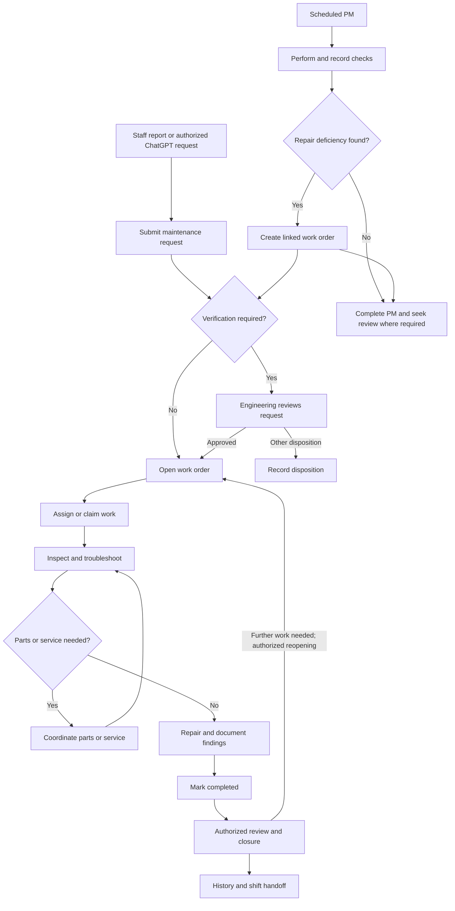

*Updated November 10, 2026.*
CMPRI Engineering connects hotel maintenance reporting, technician work, preventive maintenance, room operations, pool monitoring, purchasing, inventory, and staff communication in a desktop and mobile workspace.
An optional ChatGPT connection provides conversational access to supported records and actions.
This guide focuses on the maintenance cycle: creating and managing work orders, using equipment-specific troubleshooting, and performing preventive maintenance (PM). It also describes the supporting tools used to coordinate that work.
Application access requires an authorized staff account. This public repository contains documentation and release information. Application source code, operational records, and deployment configuration remain private.
[Open CMPRI Engineering](https://www.cmpri-engineering.com/)
## Recent Updates
The current release improves work-order editing and multitasking, alongside room reports, guest and room context, locations, and account access.
| Area | What changed |
| --- | --- |
| **Work-order editing** | Permitted dropdown selections save automatically. Grouped controls and section icons improve scanning on desktop and mobile. |
| **Multiple work orders** | Open and switch up to five work orders in one workspace while keeping other tools and their drafts open. |
| **Daily Room Ops** | Separate **Drive** and **File** actions. Drive fetches newer approved CSV attachments on demand, validates them, and applies a successful import directly. Manual files keep their review and confirmation workflow. |
| **Guest group indicators** | Group badges appear beside guest names in room operations and work-order views. The CN Railway badge recognizes the imported **CN RAILWAYS** Group Name. |
| **Manage Locations** | Grouped, expandable location records connect location details, related work orders, PM schedules, and recent completion history. |
| **Manage Users** | Active/Deactivated status is followed by the last sign-in or verification state. A small green dot indicates a user currently connected to the app. |
| **Work-order collaboration** | New note and status events notify eligible Engineering leadership, the assigned technician, and the original submitter, with duplicate recipients combined. |
| **Workspace and exports** | Responsive work-order filters, guest indicators, membership-tier help, coordinated modal styling, and PM Excel exports using the original workbook layout. |
See the workflow sections below for requirements, permissions, and limitations.
## Contents
- [Recent updates](#recent-updates)
- [The operating cycle](#the-operating-cycle)
- [1. Sign in and open the workspace](#1-sign-in-and-open-the-workspace)
- [2. Review the current operating picture](#2-review-the-current-operating-picture)
- [3. Submit a maintenance request](#3-submit-a-maintenance-request)
- [4. Review, prioritize, and assign work](#4-review-prioritize-and-assign-work)
- [5. Troubleshoot within the work order](#5-troubleshoot-within-the-work-order)
- [6. Complete, close, or reopen work](#6-complete-close-or-reopen-work)
- [7. Run preventive maintenance](#7-run-preventive-maintenance)
- [8. Resolve parts and purchasing needs](#8-resolve-parts-and-purchasing-needs)
- [9. Manage pool operations](#9-manage-pool-operations)
- [10. Maintain locations and equipment](#10-maintain-locations-and-equipment)
- [11. Communicate and hand off work](#11-communicate-and-hand-off-work)
- [12. Supporting reports and account tools](#12-supporting-reports-and-account-tools)
- [ChatGPT integration](#chatgpt-integration)
- [Updates and device caching](#updates-and-device-caching)
- [Example maintenance cycle](#example-maintenance-cycle)
- [Release and validation](#release-and-validation)
- [About this repository](#about-this-repository)
## The Operating Cycle
Work orders bring the request, diagnosis, repair, and history together. A PM inspection can also identify a deficiency that needs a linked work order.

This is a typical path, not a promise that every ticket follows every step. Drafts are not submitted work; requests can receive another disposition, and available actions depend on permissions and the record's state. PM completion and review are tracked separately from the linked repair.
## 1. Sign In and Open the Workspace
After sign-in, CMPRI presents the workspace appropriate to the staff member’s role and permissions.
| Staff function | Typical use |
| --- | --- |
| Front Desk and Housekeeping | Report problems, review permitted work orders, add permitted updates, and communicate with Engineering. |
| Technicians | Work assigned or available tickets, use troubleshooting guidance, document repairs, and perform permitted PM tasks. |
| Engineering leadership | Review requests, coordinate assignments, oversee PM, manage equipment and supplies, and perform authorized closure actions. |
| Management | Review operational information and use tools granted to the account. |
| Administrators | Maintain authorized user, role, location, and system-management functions. |
On desktop, tools open in movable, resizable windows so staff can keep related information visible together. Staff can open and switch up to five work orders in a workspace; the work-order list, Manage Locations, and Staff Notes do not count toward that limit. Opening an already open ticket brings it forward. At the limit, close one work order before opening another.
Mobile layouts adapt the workflows to smaller screens. Shared modal colors, consistent action controls, and responsive layouts help staff move between tools without losing the surrounding workspace.
Dashboard controls and available actions follow the signed-in account. A shared operational account can prompt for a staff posting or reporting name; that name identifies the contribution without creating a separate user account.
Viewing, editing, assignment, approval, and closure are separate permissions. Seeing a record does not imply permission to change every field.
## 2. Review the Current Operating Picture
A typical shift begins with the work list, current room information, pool status, scheduled PM, and recent Staff Notes.
### Work Order List
Use the list to find pending requests, open work, work in progress, urgent or high-priority work, overdue items, completed work, and other available status groups.
The filter controls show counts and adapt to desktop windows and small screens. Search, sorting, and paging help staff locate a ticket without opening every record.
A list entry brings together several kinds of information:
| Information | How it helps |
| --- | --- |
| **Work-order reference, status, and priority** | Identify the ticket and decide what needs attention. |
| **Room or property location** | Establish where the work belongs. |
| **Occupancy and checkout context** | Coordinate access with the current room-operation snapshot. |
| **Guest name and indicators** | Show available group and loyalty information alongside the current guest. |
| **Incoming reservation information** | Distinguish an upcoming stay from the current occupant. |
| **Issue summary and source information** | Understand the reported problem and available import context. |
Guest group badges appear after the guest name, rather than being treated as part of the room number. Supported indicators include CN Railway, Big Ten, and Flyover Film Studios. The same shared guest indicators are used in work-order detail and modal title bars where guest information is available.
The membership-tier help control explains the custom loyalty symbols without leaving the work list. Group affiliation, loyalty tier, room status, and ticket priority convey different information.
Opening a ticket shows its full repair record. Saved drafts remain distinct from submitted active work orders.
### Daily Room Ops
Daily Room Ops combines imported guest and housekeeping reports into the room context used by Engineering. It supports room-access planning, departure coordination, incoming reservations, and detected room moves.
The selected **Report Date** controls the view. Source-date information distinguishes a newly accepted report from an older snapshot carried forward for reference.
#### Report Set
| Report | Requirement | Purpose |
| --- | --- | --- |
| **In-House Guest List Details** | Required first for the day. | Establish the current in-house guest and stay information. |
| **Housekeeping Departures** | Optional. | Supply matching departure information, including explicit checkout times where provided. |
| **Housekeeping Arrivals** | Optional. | Supply incoming reservations and associated arrival information. |
Optional reports can be included with the guest list or added after that day's guest list has been accepted. Current and incoming guest fields remain separate.
#### Import from Drive
The **Upload Room Ops** control has two distinct actions. **Drive** uses the existing Google Drive folder that receives approved email attachments; **File** uses the manual upload workflow.
For Drive:
1. Select **Drive** when the approved reports are ready.
2. CMPRI searches the configured attachment folder for the three recognized report filenames.
3. It compares each filename's timestamp with the previously accepted report of the same type.
4. It fetches the newest eligible CSV for each type and runs the normal report and room validations.
5. A successful batch is applied directly. A status message confirms the import and shows server processing time.
6. If fetching, validation, or saving fails, the interface shows the reason. A failed batch does not replace the previously accepted report.
Drive import does not open the manual file form or ask for a second confirmation after successful validation. The **Drive** click is the event that starts acquisition: no timed polling or automatic background Drive import is used.
If there are no newer eligible reports for today, CMPRI reports that result and keeps the accepted room data.
#### Import a File
For files already on the device:
1. Select **File** and choose the original report files, or add them through the expanded upload form.
2. Include the required in-house guest list first, unless today's guest list is already accepted.
3. Optionally include housekeeping departures and arrivals.
4. Select **Submit** to validate the batch and generate the review preview.
5. Review the extracted room details and select **Confirm Import** to save.
The file workflow accepts supported CSV and image formats under the application's file limits. CSV is preferred because it preserves the exported report values without image transcription. Manual file uploads retain their preview and confirmation step.
#### Filename Freshness and Validation
Keep the original CMPRI report names. Recognized names contain the report type, property code, and `YYYY-MM-DD_HH-MM-SS` timestamp—for example:
```text
In House Guest List Details_CMPRI_YYYY-MM-DD_HH-MM-SS.csv
Housekeeping Departures_CMPRI_YYYY-MM-DD_HH-MM-SS.csv
Housekeeping Arrivals_CMPRI_YYYY-MM-DD_HH-MM-SS.csv
```
The timestamp inside the filename establishes that report's ordering. A later Drive upload or modification time does not make an older report a newer source.
- Freshness is compared separately for in-house guests, departures, and arrivals.
- The guest-list workflow requires reports dated today in the hotel's timezone.
- Optional reports may be no more than five minutes earlier than the in-house guest list.
- A replacement with different content must be newer than the accepted version of that report type.
- Purchase orders and unrelated attachments in the same folder are ignored.
- Required columns, guest-stay details, active room references, and conflicting incoming reservations are validated before saving.
- Conflicting newest copies or a report changed during acquisition require correction rather than an arbitrary choice.
- If the accepted room report changes during processing or review, the outdated save is rejected.
These are report-data checks, not a requirement to manually inspect every successful Drive import.
#### Reading the Room Context
A room can show occupancy status, the current guest, stay length, checkout information, incoming reservations, and group or loyalty indicators. Scheduled departure information supports planning; it is not proof that the guest has physically checked out.
Stay data is projected using recorded dates and times. Current guest information clears after its scheduled checkout boundary, and eligible incoming information can become the current stay at its recorded arrival boundary. This display behavior does not require another report upload and does not start another Drive fetch.
The CN Railway badge is assigned from the imported **Group Name** column. **CN RAILWAYS** is a recognized label. A guest name resembling a railway company does not by itself assign the badge. Updating the source group or moving to another effective stay changes the associated indicator.
When a room move is detected, staff can review its source and destination room numbers alongside the room-operation information.
### Room Ranker
Room Ranker groups rooms by floor and derives the displayed rank from the highest active ticket priority:
| Rank | Current ticket context |
| --- | --- |
| **A** | Low-priority work or no active tickets. |
| **B** | Medium-priority active work. |
| **C** | High- or urgent-priority active work. |
Staff can filter by rank, expand a floor, open the leading issue's work order, and use **+N more** to inspect additional issues. Completed, Closed, and Will Not Do tickets are excluded from the active ranking.
This is a ticket-based operating view, not a separate inspection score. Repair findings and ticket status remain in the work-order record.
## 3. Submit a Maintenance Request
Report the problem as observed; a technical diagnosis is not required. For example: “Room 316 is not cooling.”
1. Open **Create Work Order** or the available work-order launcher.
2. Select the room or property location and describe the issue clearly.
3. Add useful photos, video, or notes, and enter the reporting name if prompted.
4. Select **Submit Request** or **Create Work Order**, as available to your role.
The simplified form can suggest a category, priority, and equipment based on the issue and location. Staff with technical editing permission can review or adjust the available fields. Similar active work may trigger a duplicate warning; multiple distinct problems may prompt suggestions for separate work orders. Review those suggestions before proceeding.
Eligible users can save an unfinished report as a **Draft**. A draft is not a submitted active ticket. Requests from submission-only roles enter **Pending Verification**; authorized Engineering submissions can start as **Open**. If an attachment upload needs recovery, a ticket that has already been created is retained.
## 4. Review, Prioritize, and Assign Work
Authorized Engineering staff use the work lists and approval tools to review incoming requests. For each request:
1. Confirm the location and clarify the reported issue.
2. Check for duplicates and review supporting media.
3. Confirm the equipment, category, and priority where permitted.
4. Approve the request for active work or record another appropriate disposition.
5. Assign the ticket, or leave it available for an authorized technician to claim.
Assignments, status changes, and subsequent updates remain associated with the ticket. Use the work-order list to find work by status or priority and review room context before arranging access. Room report information supports planning; a scheduled checkout is not proof that a guest has physically departed.
### Work-order states
| State | Meaning |
| --- | --- |
| **Draft** | An unfinished report saved for later work or authorized review; not a submitted active ticket. |
| **Pending Verification** | A submitted request awaiting authorized verification. |
| **Open** | Active work ready for attention. |
| **In Progress** | Work is underway. |
| **Completed** | The repair or task has been recorded as complete. |
| **Closed** | An authorized user has performed final closure. |
| **Will Not Do** | An authorized disposition indicating that the work will not proceed. |
Transitions depend on role, permissions, assignment, and current state. Completion and final closure are separate actions.
### Editing and saving
In **Reported Issue**, permitted dropdown selections save automatically. Related equipment changes may update category and priority together. A confirmed value changed from the value shown when the ticket opened appears green; selecting the opening value again saves it and restores the usual color. If a save cannot be confirmed, CMPRI displays an error and leaves the selection available.
**Save Changes** remains available for other unsaved edits. Selecting **Closed** changes the status without closing the work-order view. If another person changes a ticket during editing, CMPRI detects the newer revision and preserves local unsaved text for comparison; reconcile the current record before submitting an outdated update.
## 5. Troubleshoot Within the Work Order
The work order brings the reported issue, location, equipment, notes, attachments, assignment, and repair information together. Use it to carry the diagnosis forward from one person or shift to the next.
### Technician workflow
1. Read the reported issue, room context, notes, and attachments. Check previous findings before repeating work.
2. Confirm the equipment associated with the issue, including its manufacturer and model when available.
3. Open **Suggested Troubleshooting** and review the guidance that matches the symptoms or diagnostic code.
4. Perform the appropriate checks and record observations, readings, codes, and results as you go.
5. Document work performed and update permitted fields and status. If parts, access, a vendor, or further diagnosis is needed, record the outstanding need and coordinate follow-up.
6. After the repair, record the outcome and use the permitted completion action. An authorized user can then review and close the ticket.
### Equipment-matched guidance
Selecting equipment lets CMPRI look for verified documentation matching its manufacturer and model family or model number. Where suitable material is available, **Suggested Troubleshooting** can show issue-relevant steps, diagnostic and error-code references, manufacturer guidance, PDF excerpts, and links to original manuals and referenced pages. Individual steps can be copied. Recorded work notes help filter steps already completed.
If guidance is missing, ambiguous, or does not match the issue, the interface says so. Confirm the equipment identity and consult the available documentation or arrange further diagnosis; the suggestions do not establish a diagnosis on their own.
### What to record
Write notes that let the next person understand the repair without repeating the investigation:
- **Checked:** equipment, symptoms, and tests performed.
- **Found:** observations, readings, diagnostic codes, and relevant results.
- **Changed:** adjustments, repairs, or parts used, as applicable.
- **Next:** remaining work, parts or service follow-up, and any access needs.
Attach supporting media when useful. Where linked external activity is available, the ticket may also show purchases, shipments, service tickets, warranty activity, or supplier follow-up.
## 6. Complete, Close, or Reopen Work
1. When the task is finished, record the repair and outcome. Available fields include final action or root cause and, where permitted, parts, cost, labor hours, and other details.
2. Use the permitted action to mark the work **Completed**.
3. An authorized user reviews the completed work and performs final **Closed** status.
If work will not proceed, an authorized user can record **Will Not Do** with an explanation. If a closed ticket needs further attention, a user with reopening permission can return it to an allowed working state. Ticket history preserves the sequence of updates.
## 7. Run Preventive Maintenance
The PM workspace brings routine checks, inspections, quarterly room maintenance, approvals, deficiencies, and history together. Completion of a PM task and reviewer approval are separate records. A repair identified during PM follows the work-order workflow; it does not replace the PM record.
### Choose the work
Select a week with the week selector or **This week**. Progress indicators show routine completion, open forms, and items needing follow-up. Mobile frequency and day controls help staff find the relevant checks.
| Section | Use it to |
| --- | --- |
| **Weekly Sheet** | Perform daily, weekly, and monthly routine tasks. Each checkbox saves independently for its task and date or period. |
| **Inspection Forms** | Open scheduled forms or browse the imported catalog; record results, readings, inspection rows, initials, and required details. |
| **Quarterly PM** | Find a room, complete its checklist, record condition/rank and deficiencies, and enter the completion date. |
| **Maintenance History** | Review saved checklist responses, inspection records, and room completion information; export available records. |
### Perform and document PM
**Routine checks:** Mark the applicable task for its date or period on the Weekly Sheet. Each mark belongs to that task and period. Technician views show recorded completion; reviewer views distinguish work needing approval from approved work. Authorized reviewers can use **Needs Approval** to find pending work.
**Inspection forms:**
1. Open a scheduled form or choose one from the catalog.
2. Enter the required details; mark items complete, needs follow-up, or not applicable.
3. Add required measurements or inspection rows, observations, deficiencies, and the follow-up plan.
4. Select **Save draft** if the form is unfinished. Select **Mark complete** when the required information has been entered.
The form retains its source-document reference. Pool readings are entered in **Pool Log**, accessible through the linked PM form where applicable.
**Quarterly room PM:** Open the room's form, perform its checklist, record condition/rank and deficiencies, and enter the completion date. The completion date, checklist responses, and review status convey different information; checking one item does not complete the entire room PM.
### Turn a deficiency into a repair
1. Describe the deficiency and the follow-up needed on the inspection form.
2. Select the work-order location and create the linked work order.
3. Continue the diagnosis, repair, and closure in that ticket; return to the PM form to access the linked ticket.
The ticket carries the form reference, inspection period, marked deficiencies, and follow-up notes. Continue to complete and submit the PM form for review as applicable; creating a ticket does not itself complete or approve the PM.
### Review history and export
Authorized reviewers use the available approval or rejection actions. Review saved responses, inspection records, and room completion information in **Maintenance History**.
Excel and CSV exports provide reporting copies. **Export Excel** fills supported saved information into the original PM tracking workbook layout while preserving existing formatting, formulas, and untouched content. Editing the downloaded workbook does not update the saved CMPRI record.
## 8. Resolve Parts and Purchasing Needs
Inventory and purchasing tools organize supplies, replacement equipment, vendor proposals, and shipments needed for repairs.
Authorized staff can maintain inventory items, vendors, contacts, equipment compatibility, reorder information, order ideas, and repair-or-replace proposals.
### Supply Workflow
1. Identify the required item or equipment.
2. Check inventory and available quantities.
3. Record a purchasing need or vendor proposal.
4. Create or review the purchase order.
5. Track shipments and backorders.
6. Record quantities physically received.
7. Document parts used and remaining work on the repair ticket.
### Purchase Orders and Receiving
Orders can be entered manually or brought through configured source-review/import workflows.
Before receiving stock, authorized staff review acceptance, descriptions, quantities, inventory mapping, and package or unit conversion.
Shipment information provides delivery context. Physical receipts establish what has been received into inventory.
Partial receiving supports multiple deliveries.
Cumulative receiving records the total received to date and adds the newly received difference.
**Example:** Four cases are ordered, with twelve filters per case.
- Receiving two cases adds twenty-four filters.
- Updating the cumulative received total to four after the remaining delivery adds the remaining twenty-four.
- Saving the unchanged total again preserves the same received quantity.
Order evidence, receiving history, and recorded values support later review.
Connected supplier and import workflows depend on the integrations enabled for the deployment.
## 9. Manage Pool Operations
Pool operations combine the daily testing record with the shared **Pool** status control.
1. Open **Pool Log** and select the facility and date.
2. Review any readings and daily checks already saved.
3. Enter the required results and observations.
4. Save the log and read the returned status, closure reasons, and warnings.
5. Record a retest or use the permitted hold/reopening controls when appropriate.
#### Samples, Daily Checks, and Retests
AM and PM testing are separate samples. Each sample records pH and a bromine range. One collected sample is represented as a shared result for the shallow and deep fields; CMPRI does not infer a collection location.
Temperature, flow rate, main-drain visibility, and filter backwash are daily checks recorded once per day. The PM sample can be added later without changing the saved AM sample. A later retest is recorded as an additional result, preserving earlier findings.
The **Pool Specs** dialog provides the configured inspection and operating references without crowding the entry form.
#### Operating Status
Effective status considers operating hours, required testing, recorded failures, manual holds, and any pending authorized reopening. A passing result does not clear an independent manual hold.
Authorized staff can select **Close pool** and supply a reason. **Open pool** requests confirmation and clears eligible manual holds only when current tests pass and operating hours permit. Unsafe or missing readings and other required or unclassified holds cannot be overridden. CMPRI records automatic reasons for unsafe readings.
**Daily pool activity** shows dated, timestamped saved reading and note changes together with open and close actions. Use the single **Save Pool Log** control beside the date to save the current entry.
A closed state can remain while required testing or an authorized reopening decision is pending. Eligible recipients receive closure notifications through the available notification channels.
CMPRI records observations and applies its configured status rules. The log is not a chemical-dosing calculator or a replacement for required pool-operation procedures. Linked PM checks use Pool Log for the actual readings.
## 10. Maintain Locations and Equipment
### Manage Locations
Locations are the common reference connecting work orders, equipment, and preventive maintenance.
The **Manage Locations** modal groups active locations by Location Type. Within each group, room numbers and location names are naturally ordered so staff can browse property areas without a long unstructured list.
Select a location to expand its details. The panel brings together:
| Detail | Available information |
| --- | --- |
| **Location identity** | Room number or location name, Area, and Location Type. |
| **Linked PM plans** | Plan title, description, scheduled frequency, and last completion date. |
| **PM due state** | The recorded next due date, including overdue or unset-date indicators. |
| **Recent PM history** | Recent linked completion dates and recorded completing staff. |
| **Related work orders** | Tickets tied to the selected room or location, with issue and status. |
A PM-plan count on the location row helps staff identify records with linked maintenance schedules. Selecting a related ticket opens that work order's repair record.
#### Edit or Add a Location
**Edit Location** sits beside **Open PM Tracker** in the expanded panel. Each action appears only when the account has the relevant permission.
The editor supports the location name, Area, Location Type, and optional room number. Editing an existing record uses Area and Location Type dropdowns based on the options already present in the property records. **Add Location** supports a new location with the available type suggestions.
Required fields are checked before saving, and an unsuccessful save displays its error without claiming the record was updated.
**Open PM Tracker** opens the available PM workspace. The location panel is a way to inspect linked maintenance context; work-order repairs and PM completion continue in their respective workflows.
### Assets and Documentation
Equipment records identify the asset, assigned location, and manufacturer/model details.
Documentation can be associated with equipment and verified for troubleshooting use.
Accurate identity and location records help technicians select the correct equipment and retrieve relevant guidance.
### Enseo Assignments
Authorized staff can record television and set-top-box assignments, destinations, room sub-locations, and supported pairing or endpoint details.
Recorded moves preserve assignment history.
### Front Desk Quick Guides
Available guest-room, television, and door-lock reference material supports permitted staff handling common operational issues.
These guides complement equipment-specific troubleshooting inside technician work orders.
## 11. Communicate and Hand Off Work
### Staff Notes
Staff Notes supports shift information, coordination, and discussion.
Staff can post notes, reply, attach supported media, and select supported mentions for people, roles, locations, or work orders.
Work-order references help readers return to the relevant repair.
Shared Front Desk accounts capture a posting name. Name confirmation and display labels help readers identify the staff contribution while the underlying shared account retains its normal access permissions.
The mention picker distinguishes actual user accounts, roles, captured shared-account staff names, locations, and work-order references. A display-only shared-account name is not an independently enrolled device account. Selecting a location mention does not turn its room number into a work-order reference.
Unread indicators help eligible staff locate notes requiring attention.
### Notifications
In-app notifications direct eligible users to requests, assigned work, mentions, pool closures, and other supported events. Device push is available where enabled and permitted by the browser or device.
For new work-order notes and status changes, the current notification audience includes eligible Engineering leadership, the assigned technician, and the original submitter. A person who belongs to more than one recipient group receives one alert for that event.
The note entered when a ticket is first created is part of its creation event; it does not generate a second, separate new-note alert. Creation wording distinguishes a request needing verification from a ticket created as open work.
Shared-account submissions notify the submitting account where eligible. An entered reporting name does not create a separate notification account.
Delivery remains subject to current access, device enrollment, notification schedules, and the event's recipient rules. Assignment, explicit mentions, Staff Notes, pool events, and other notification categories keep their own policies.
### End-of-Shift Handoff
1. Update work-order notes and statuses.
2. Identify repairs awaiting parts, vendor action, access, or further diagnosis.
3. Save unfinished PM forms and document deficiencies.
4. Confirm pool readings, holds, and closure reasons.
5. Post a Staff Note linking work the next shift needs to continue.
Keep repair findings and status in the work-order record. Use Staff Notes to coordinate the handoff.
## 12. Supporting Reports and Account Tools
| Tool | Operational use |
| --- | --- |
| **GSS Reports** | Review available guest-satisfaction reports, rankings, and prior periods. |
| **Hours Tracker** | Maintain permitted personal hours and leave information. |
| **Candidate Questionnaires** | Allow authorized reviewers to inspect employment questionnaires. |
| **Manage Users** | Maintain authorized access and role assignments. |
| **Manage Profile** | Maintain available preferences and account settings. |
| **Feedback** | Submit application feedback for authorized review. |
| **ChatGPT Connection** | Connect an individual account for the supported conversational workflows below. |
Available tools and actions depend on the account.
### Manage Users
Authorized account managers can invite users, assign permitted roles, and deactivate or reactivate eligible accounts. Editing scope depends on the manager's role and the target account; an account shown in the list may be view-only.
Each account keeps its existing **Active** or **Deactivated** status. In the same muted status line, CMPRI shows the last sign-in reported by Supabase Auth or **Waiting for verification** when confirmation is still outstanding.
A confirmed account that has not signed in can show **Never signed in**. If authentication metadata cannot be read, CMPRI shows that sign-in information is unavailable rather than incorrectly calling the account unverified.
A small green dot appears when an active user is currently connected to the app. No dot is shown when that user is not online. This is a presence indicator, not a guarantee that someone is available or looking at the screen.
Deactivation retains the account's linked CMPRI history. It is separate from removing historical work records.
## ChatGPT Integration
CMPRI includes an optional ChatGPT connection that lets authorized staff work with supported records through conversation.
Staff can ask questions about accessible information and explicitly request supported changes without navigating every screen individually.
The connection uses **OAuth** and the **Model Context Protocol (MCP)**.
Each person signs in with their own CMPRI account. CMPRI checks active status, property membership, role, permissions, and connection access when tools are used.
### Connect an Account
1. Open **Manage Profile → ChatGPT Connection**, where available, and follow its instructions.
2. In ChatGPT’s app/connector settings, add CMPRI using the endpoint shown in the application and select OAuth authentication.
3. Sign in using the account linked to the CMPRI profile.
4. Approve the requested access.
5. Return to CMPRI to review connection status.
The connection can be read-only or read-and-write, depending on the authorization granted.
This OAuth connection does not require staff to share CMPRI credentials or supply an OpenAI API key.
Custom-connection availability depends on the ChatGPT account and organization settings.
### What ChatGPT Can Read
The connector exposes supported views available to the connected account.
Depending on permissions and configuration:
| Area | Supported uses |
| --- | --- |
| **Work orders** | Search accessible tickets; read a specific ticket, activity, and available attachment information; summarize status, assignments, and findings. |
| **Rooms and daily operations** | Find active locations and read available room-operation records, out-of-order rooms, departures, and detected moves. |
| **Equipment** | Search equipment and read available records, documentation information, and maintenance references. |
| **Inventory and vendors** | Read supported inventory, vendor, compatibility, and proposal records in the engineering catalog. |
| **Purchasing** | Review available purchases, shipments, and related operational records. |
| **Pool** | Read a dated facility log, recorded testing, missing daily checks, and returned operating-status information. |
| **PM references** | Read supported PM workbook references where configured and permitted. |
| **Administration** | Read permitted drafts, feedback, user-management information, and Enseo assignments. |
| **Personal hours** | Read the connected account’s own timesheet where that private feature is enabled. |
ChatGPT can organize returned information into a repair summary, outstanding-work list, or draft handoff.
Saving or posting a result requires a supported action and an explicit request.
### What ChatGPT Can Change
A write requires both a read-and-write connection and the relevant CMPRI permission.
Supported changes include:
- **Work orders:** Create requests, import validated data, update permitted fields, assign work, and change status where authorized. Supported cancellation records **Will Not Do** while retaining history.
- **Drafts:** Create, update, or remove permitted drafts under ownership and supervisory rules.
- **Room operations:** Validate and import structured room reports extracted from supplied images or other supported inputs.
- **Equipment and locations:** Create or update equipment and update permitted room/location records. Verified equipment changes follow documentation revision rules.
- **Engineering catalog:** Create or update supported inventory, vendor, contact, compatibility, order-idea, and proposal records.
- **Purchasing operations:** Update supported purchase or shipment statuses and run an authorized mailbox scan where enabled.
- **Pool logs:** Save supplied readings, required daily checks, remarks, and supported retests under normal validation.
- **Enseo assignments:** Save validated batches of device-assignment changes.
- **Profile and administration:** Update permitted profile details, submit or review feedback, and perform authorized user-management actions.
- **Personal hours:** Save the account’s own complete timesheet period where enabled. Clock-in and clock-out are separately activated, account-specific features.
The connector exposes a defined set of actions.
Native PM form completion and approvals, Staff Notes posting, and physical PO receiving are handled through their application workflows when no corresponding connector action is available.
Direct PM spreadsheet writes are currently disabled.
### How a ChatGPT Work-Order Request Flows
For:
> Create a work order for Room 316: the air conditioner is not cooling.
The workflow is:
1. ChatGPT identifies the location and reported issue.
2. An unclear or ambiguous location requires clarification.
3. CMPRI checks submission permission, validates the location, applies attribution and classification rules, and checks duplicates.
4. A successful response returns the created work-order information.
5. The ticket follows the normal verification, assignment, repair, and closure workflow.
For an update, the current record and revision must be checked before permitted changes are submitted.
The tool response determines whether the change succeeded. Preparing a change or validating an import does not confirm that it was saved.
### Daily Room Ops from Drive Through ChatGPT
Where the current connector schema exposes the supported Drive import mode, an authorized account can request newer reports from the configured attachment folder through the existing room-import action.
The connected workflow previews the source-backed import first. An explicitly requested confirmation must refer to that preview's accepted-report version and source fingerprint; changed files require a new preview. It uses the same acquisition and validation rules as the application.
This connected preview/confirmation sequence is distinct from the application's **Drive** button, which validates and applies an eligible batch directly in one action.
Connector settings can retain an older tool schema after an application update. If a tool rejects an input mode before the request reaches CMPRI, the application interface remains the supported alternative; a connector error is not evidence that an import was saved.
### Room Reports Through ChatGPT
An authorized user can supply report images for ChatGPT to read and prepare:
1. Supply all pages and identify the intended report/date.
2. ChatGPT reads CMPRI’s import requirements and extracts required room information.
3. Current and incoming guest fields remain separate, with printed dates, times, and page details preserved.
4. Unreadable or missing required fields need clarification.
5. The prepared import is validated before saving.
6. When explicitly asked to import, ChatGPT submits the verified data.
7. After success, the saved view can be read back to report out-of-order rooms and detected moves.
### Pool Entry Through ChatGPT
ChatGPT can read the existing log, ask for missing readings or daily checks, and submit values the user supplies.
Normal edit restrictions apply. Existing samples and history are retained.
Returned closure reasons and warnings must be reported back to the user.
Reopening and manual holds continue to follow CMPRI’s operating rules and permissions.
### Example Requests
Each example requires the corresponding access and supported action:
- “Show the work orders I can access for Room 316.”
- “Summarize the findings and remaining work on this ticket.”
- “Create a work order for the lobby: the ceiling light is flickering.”
- “Assign this work order to the technician I selected and mark it In Progress.”
- “Record that the filter was replaced and mark this repair Completed.”
- “Find the equipment and available documentation references for this room.”
- “Read today’s pool log and tell me which required checks are missing.”
- “Validate these report pages and show missing information before saving.”
- “Review the available shipment records for this repair.”
### Access and Revocation
Read-only connections expose permitted reads.
Write-enabled connections additionally expose actions allowed by the user’s current CMPRI permissions.
Every change must be explicitly requested and remains subject to normal validation.
The connection screen provides **Revoke ChatGPT access**. Revocation prevents subsequent use of the revoked connection.
An older read-only connection can be revoked and reconnected with approved read-and-write access where appropriate.
## Updates and Device Caching
CMPRI caches suitable information locally to make repeat views faster and reduce unnecessary requests.
Change notifications help affected windows and browser tabs refresh. Successful writes invalidate relevant cached records so related views can reload current information.
Daily Room Ops distinguishes two kinds of activity: ordinary room-data refreshes keep the view current, while a **Drive** click explicitly requests report acquisition. Refreshing the room view does not schedule another Drive import.
Cached application information remains scoped to the signed-in user, property, and permissions.
Sign-out clears the application’s device data cache. Sensitive categories use restricted caching or continue through network requests. Raw Drive report CSVs bypass the device data cache.
Local caching supports faster reads. Online authorization and successful saves remain part of the workflow; this is not a general offline work-order submission system.
### Seasonal Artwork
Seasonal artwork uses a separate local asset cache.
The Thanksgiving layouts include an animated turkey, separate pumpkins, greeting, and layered leaves for desktop and mobile.
Cached artwork can load and animate offline without repeatedly fetching database records.
Landed leaves accumulate in persistent piles on their existing layers. The desktop greeting sits at the upper right with clearance for the expanded header.
Changed artwork files receive updated content versions.
## Example Maintenance Cycle
1. Front Desk reports a guest-room air conditioner that is not cooling and attaches a photo.
2. The request enters verification.
3. Engineering reviews the location, issue, priority, and equipment.
4. The approved ticket is assigned to a technician.
5. The technician reviews prior findings and available equipment-matched troubleshooting.
6. Inspection identifies a replacement part.
7. Authorized staff review inventory or purchasing needs.
8. The part is obtained through the appropriate inventory or receiving workflow.
9. The technician completes the repair and records findings, action, root cause, and permitted work details.
10. The technician marks the work complete.
11. An authorized user performs final closure.
12. History remains available, and remaining operational follow-up is included in the shift handoff.
A scheduled PM inspection can enter the same cycle through a linked deficiency work order.
An authorized ChatGPT connection can assist at supported points—for example, creating the initial request, retrieving ticket information, summarizing findings, or submitting a permitted update when explicitly requested.
## Release and Validation
### November 8, 2026
The current workflow documentation includes:
- Event-driven Drive discovery of the three Daily Room Ops CSV report types.
- Independent filename-timestamp comparison against accepted reports of the same type.
- A compact Drive/File upload control, with the title and Report Date label centered above their controls.
- Direct application of a successfully validated Drive batch, with failure reasons and server-duration reporting.
- A separate manual upload form that retains review and explicit confirmation.
- CN Railway group recognition, including **CN RAILWAYS**, and consistent placement of guest indicators.
- Account status, authentication sign-in/verification information, and connected-user presence indicators.
- Work-order note and status notifications for the eligible collaboration audience.
- Responsive work-order list controls and membership-tier help.
### Earlier Workspace Improvements
The November 7 release work included shared modal palettes, Manage Locations refinements, scrollbar and resize repairs, consistent mobile action widths, application data caching, and desktop/mobile seasonal artwork updates.
The more detailed Manage Locations and PM export workflows are described in their operating sections rather than only in a release list.
### What Validation Establishes
Validation combines automated report parsing and API tests, permission and concurrency checks, production builds, and desktop/mobile browser tests.
The Daily Room Ops rollout also included staff-confirmed live Drive fetching and an accepted import of the three reports. Follow-up interface and direct-import changes were covered by isolated desktop/mobile tests and deployed production availability checks.
Production availability and API access-denial checks do not imply that every account, physical device, or external integration has been exercised. Feature availability still depends on the signed-in account and configured integrations.
Processing-time messages describe server work for the measured request. They do not reconstruct an earlier browser click or a period spent reviewing a manual preview.
## About This Repository
`cmpri-engineering-overview` is the public documentation repository for CMPRI Engineering.
It explains the application, operating workflows, and supported ChatGPT integration while the development repository and operational information remain private.
This repository is an overview, not a distributable application or self-hosting package. It does not include staff credentials, guest records, report attachments, private integration settings, or production deployment instructions.
