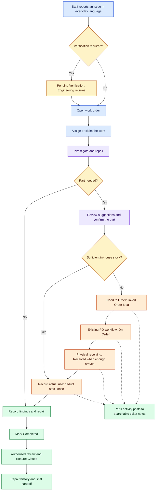

# CMPRI Engineering Overview

A desktop and mobile workspace for hotel maintenance, engineering, and daily operations—from the first problem report to the repair, final review, and next shift's handoff.

CMPRI Engineering connects work orders, troubleshooting, room operations, preventive maintenance, equipment, inventory, purchasing, pool checks, staff communication, and management tools. Each account sees the tools and actions its role permits.

[Open CMPRI Engineering](https://www.cmpri-engineering.com/) · [Privacy policy](https://www.cmpri-engineering.com/privacy)

Application access requires an authorized staff account. This repository is the public product overview; application source code, operational records, and deployment configuration are private.

**Reading guide:** 🔵 Work orders · 🟣 Troubleshooting and equipment · 🟢 Operations and maintenance · 🟠 Supplies and purchasing · 🟡 People and account tools

## On This Page

- [Easy Work Order Submission](#easy-work-order-submission)
- [Troubleshooting Guides Within the Work Order](#troubleshooting-guides-within-the-work-order)
- [Work Order Flow](#work-order-flow)
- [Feature Directory](#feature-directory)
- [Work Orders and Technician Dashboard](#work-orders-and-technician-dashboard)
- [Labor and Parts](#labor-and-parts)
- [Daily Room Operations](#daily-room-operations)
- [Room Ranker](#room-ranker)
- [Preventive Maintenance](#preventive-maintenance)
- [Pool Log and Pool Status](#pool-log-and-pool-status)
- [Locations, Assets, and Enseo Assignments](#locations-assets-and-enseo-assignments)
- [Inventory, Vendors, and Proposals](#inventory-vendors-and-proposals)
- [Purchase Orders, Shipments, and Receiving](#purchase-orders-shipments-and-receiving)
- [Staff Notes and Notifications](#staff-notes-and-notifications)
- [GSS Reports](#gss-reports)
- [Hours Tracker](#hours-tracker)
- [Candidate Questionnaires](#candidate-questionnaires)
- [Profiles, User Management, and Feedback](#profiles-user-management-and-feedback)
- [Photos, Documents, and Text Recognition](#photos-documents-and-text-recognition)
- [Optional ChatGPT Connection](#optional-chatgpt-connection)
- [Desktop and Mobile Workspace](#desktop-and-mobile-workspace)
- [Roles and Permissions](#roles-and-permissions)
- [How the App Is Built](#how-the-app-is-built)
- [Application Access](#application-access)
- [About This Repository](#about-this-repository)

---

## Easy Work Order Submission

🔵 **Report a problem in plain language.**

1. Open **Create Work Order** or **+ Work Order**.
2. Choose a room or property location.
3. Describe the problem—for example, “Room 316 is not cooling.”
4. Add photos, video, or notes when useful.
5. Submit the request, or save a draft to finish later.

The form can suggest category, priority, and equipment from the issue and location. Similar active work can trigger a duplicate warning. Staff do not need to diagnose the equipment before reporting a problem.

Requests from submission-only roles enter **Pending Verification**. Authorized Engineering submissions can begin as **Open**. Drafts remain unfinished reports until submitted.

## Troubleshooting Guides Within the Work Order

🟣 **Bring equipment documentation into the repair.**

**Suggested Troubleshooting** uses the selected equipment's current approved, model-matched PDF to connect a reported symptom or diagnostic code with documented instructions. The guide provides source material for comparison and explains when suitable guidance is unavailable.

Technicians can record checklist progress, findings, and repairs; the Chief Engineer can verify checklist work. Checklist activity is retained and summarized in a combined note for each editing visit. Checking steps does not complete or close the ticket.

The guide extracts instructions directly from the approved equipment PDF without AI-provider calls or web searches. It is separate from the optional ChatGPT connection and the local OCR reader.

## Work Order Flow

🔵 **Follow one ticket from the first report to the next shift.**

**Flow colors:** 🔵 Reporting and assignment · 🟡 Decisions and review · 🟣 Investigation · 🟠 Parts and purchasing · 🟢 Completion and history

This is a typical path. Permissions and the ticket's state determine available actions. Authorized staff can also reopen work or record **Will Not Do** with an explanation. PO receiving and inventory usage remain separate actions.

## Feature Directory

| Area | Tools and purpose |
| --- | --- |
| 🔵 **Work orders** | Submission, drafts, verification, assignment, claiming, searchable ticket notes, media, troubleshooting checklists, Labor & Parts, completion, closure, reopening, and permitted imports. |
| 🔵 **Technician Dashboard** | Assigned work, unassigned coverage, due-date context, claiming, and active notifications. |
| 🟢 **Daily Room Ops** | Guest, departure, and arrival reports; room access planning; room-status summaries; and report imports. |
| 🟢 **Room Ranker** | A/B/C room rankings based on active work-order priorities and counts, grouped by floor. |
| 🟢 **Preventive Maintenance** | Daily, weekly, monthly, and quarterly work; inspection forms; approvals; history; and exports. |
| 🟢 **Pool Log and Pool** | AM/PM samples, daily checks, retests, chemical usage with inventory deductions in Remarks, closure reasons, holds, and shared operating status. |
| 🟣 **Manage Locations and Assets** | Rooms, property areas, equipment details, linked tickets, PM context, manuals, and documentation verification. |
| 🟣 **Enseo Assignments** | Physical TV and set-top-box locations, pairing, endpoints, device moves, and assignment history. |
| 🟠 **Inventory and Labor & Parts** | Per-part status and summary pills, issue-based supply suggestions, on-hand/reserved/available counts, confirmed work-order and pool chemical usage, stock deductions, linked Order Ideas, vendors, and proposals. |
| 🟠 **POs** | Orders, approval evidence, item lines, shipments, backorders, physical receiving, stock, and item-spending summaries. |
| 🟡 **Staff Notes and notifications** | Shift handoffs, replies, media, mentions, linked work, in-app updates, and supported device push. |
| 🟡 **GSS Reports** | Dated guest-satisfaction scorecards, rankings, sample sizes, source trends, and previous reports. |
| 🟡 **Hours Tracker** | Personal time entries, two-week totals, pay estimates, leave entries, and configured leave balances. |
| 🟡 **Candidate questionnaires** | Authorized human review of submitted questionnaires and original résumé PDFs. |
| 🟡 **Account and administration** | Profile preferences, notification settings, ChatGPT authorization, user access, roles, and feedback. |

Availability depends on the account's role, record state, and configured integrations.

---

## Work Orders and Technician Dashboard

🔵 **Keep the report, repair, and history together.**

### Review and assign

Engineering checks the location, description, supporting media, possible duplicates, and priority. Approved work can be assigned to a technician or left for an authorized technician to claim.

The work list supports search, filters, sorting, and status groups. The **Technician Dashboard** separates **Assigned Work** from **Unassigned Coverage**, with ticket and due-date context and active notifications.

### Investigate and repair

A ticket brings together the reported issue, room context, selected equipment, attachments, notes, troubleshooting progress, and repair history. Staff record what they checked, found, changed, and still need to address. Compact equipment and assignment fields keep the report easy to scan. Current guest details remain beneath the room, while incoming reservation badges stay together at the far right in their existing order.

Use **In Progress** where permitted. Parts and outside-service follow-up can remain connected to the repair through notes and the relevant supply workflows.

### Complete, review, and close

Record the repair, final action or root cause in the ticket notes, along with permitted parts, cost, or labor details. The compact note input sits at the bottom of the ticket with Upload, Camera, and Submit Note beside it. Closure information stays in the shared history rather than a separate Closure Details panel. Mark the task **Completed** when the work is finished.

**Completed** and **Closed** are separate stages. An authorized reviewer performs final closure. Authorized staff can reopen work or record **Will Not Do** with an explanation when a repair will not proceed.

**Typical path:** Report → Verification when required → Open → Assign or claim → Investigate and repair → Completed → Authorized closure → Repair history and handoff.

### Import existing issues

Where authorized, the import workspace accepts SafetyCulture or spreadsheet issue lists from pasted tables or CSV, TSV, and TXT files. Staff parse and preview rows before importing. The workflow validates locations, blocks repeated source IDs, and skips likely duplicates, with links to existing tickets where available.

## Labor and Parts

🟠 **Connect each confirmed part to inventory and purchasing, with all activity in the ticket notes.**

**Labor & Parts** and **Suggested Troubleshooting** both start collapsed. Their matching gold titles keep a triangle visible in both states: right-pointing when collapsed and down-pointing when expanded. Open **Labor & Parts** to review the selected part, its larger status control, supply, quantities, and labor details together on desktop and mobile.

### Select the part and supply

The work order's current issue narrows suggested parts and in-house supplies using everyday wording. For example, “Bathroom light is out” can surface lighting supplies without deciding which component failed.

Suggestions update when the issue changes. They do not replace an already selected part, change recorded usage, or create an order. **Show all supplies** expands the full inventory list.

Selecting a saved part with a confirmed inventory link fills **Supply** automatically. Otherwise, staff choose the correct inventory item; an approximate name or symptom does not establish a stock match. Explicit parts mentioned in technician notes—including needed, ordered, used, or replaced items—can be offered for review without automatically ordering or deducting anything.

### Track each part's status

The **Status** control applies to the selected individual part, not the whole work order. Its choices appear in this order:

| Status | What it means in CMPRI |
| --- | --- |
| **In-House** | The part is mapped to sufficient available inventory when saved. |
| **Need to Order** | Saving the requirement creates or updates a linked **Order Idea** in the existing inventory workflow. It does not create a PO. |
| **On Order** | The linked PO establishes that the part is ordered under CMPRI's existing purchasing rules. |
| **Received** | Recorded physical receipts cover the quantity needed for that part, using the inventory unit. |

**On Order** and **Received** reflect linked purchasing and receiving records; they cannot be established by changing a dropdown alone. Partial receipts leave an unmet requirement **On Order**. Cancelling remaining PO work does not erase a part's completed physical receipt.

If a linked PO item's identity or unit mapping changes, staff review and relink it. CMPRI does not silently substitute a different supply for the repair.

### See parts status at a glance

A compact **parts status pill** appears immediately after the **priority pill** in both the work-order list and the open work order. Both views use the same colors and height on desktop and mobile.

| Parts status | Pill color |
| --- | --- |
| **In-House** | ⚪ Gray |
| **Need to Order** | 🟠 Amber |
| **On Order** | 🔵 Blue |
| **Received** | 🟢 Green |

For a ticket with parts in different stages, the summary shows the first unresolved stage: **Need to Order**, then **On Order**, then **In-House**. It shows **Received** when all recorded parts are received. Tickets without recorded parts have no parts status pill.

The pill follows the saved parts and linked purchasing/receiving records. Staff continue to review each individual part in **Labor & Parts**; the summary does not change those records.

### Record actual usage and inventory counts

The supply list shows **on hand**, **reserved**, and **available** quantities. Staff enter the quantity and unit actually used, then choose **Record supply use**.

Recording usage deducts available inventory and writes the ticket note together. Retrying an interrupted save confirms the same operation rather than deducting stock twice. Counts cannot be overdrawn, and items tracked as **Each** require whole-item usage.

For example, **12 on hand − 2 reserved = 10 available**. Using **1 Each** leaves **11 on hand and 9 available**. These numbers illustrate the calculation; actual counts come from CMPRI.

PO receiving adds physically received stock through the existing receiving workflow. A needed part, Order Idea, shipping notice, or status selection does not add or consume inventory.

### Keep one ticket-note history

Part requirements, Order Ideas, PO changes, physical receiving, and recorded usage post to the work order's existing ticket notes. Usage entries retain the item, quantity/unit, technician, date/time, and stock change. Staff can find work orders using part names or note text.

There is no separate Labor & Parts note field or duplicate parts-history panel. Existing **Hours** and **Cost** remain in the section; legacy recorded parts information is preserved.

All matching and workflow checks use application rules. **The Labor & Parts workflow makes no AI calls.**

## Daily Room Operations

🟢 **Plan work around room use and access.**

**Daily Room Ops** combines in-house guest, departure, and arrival reports while keeping current occupants and incoming reservations separate. Staff can search room and guest context, review status summaries, and use room information to plan maintenance access.

- **Drive:** Fetch newer approved CSV reports from the configured folder. A successfully validated batch is applied directly.
- **File:** Upload supported CSV reports, review the preview, and confirm the import.

The in-house guest list is required first for the day; departure and arrival reports can follow. Selecting **Drive** starts acquisition; refreshing the room view does not start another import.

The latest accepted report remains available until replaced by a newer verified report. Guest stays expire at their recorded dates and times. Scheduled checkout and projected availability still require physical checkout and room-readiness confirmation through property procedures.

## Room Ranker

🟢 **See maintenance priorities across rooms and floors.**

**Room Ranker** groups rooms by floor and ranks them using the original priorities and counts of active tickets. The highest applicable rank wins:

| Rank | Meaning |
| --- | --- |
| **A** | Fewer than 3 Low tickets and no higher-priority tickets. |
| **B** | 3 Low tickets, or 1–2 Medium tickets. |
| **C** | 4 or more Low tickets, 3 or more Medium tickets, or any High or Urgent ticket. |

At 3 Low tickets, those tickets automatically rise to Medium priority. At 4 or more Low tickets or 3 or more Medium tickets, the affected tickets rise to Urgent and are due today. As the number of active tickets falls, affected priorities step down and return to their original values; due dates changed by automatic escalation are restored when that escalation ends. Urgent work orders are due today when created or changed to Urgent.

Active property users receive a notification when a room's rank changes, including when it improves; work-order creation alerts continue separately. Phone delivery follows each user's notification settings.

Staff can filter by rank, expand floors, open a room's leading issue, and view additional active issues. The **?** beside the close button opens a ranking key. **Completed**, **Closed**, and **Will Not Do** tickets are excluded from the ranking.

## Preventive Maintenance

🟢 **Organize recurring work and follow-up repairs.**

The PM workspace includes **Weekly Sheet**, **Inspection Forms**, **Quarterly PM**, and **Maintenance History** views.

- Record daily checkbox tasks, weekly work, and monthly maintenance.
- Complete scheduled inspection forms, readings, notes, and deficiencies.
- Track quarterly room maintenance.
- Save unfinished forms and return to them later.
- Create linked work orders for repairs found during inspections.
- Review checked tasks, open forms, overall progress, and follow-up needs.
- Track completion separately from reviewer approval.
- Export weekly CSV and Excel reporting copies of saved work.

Where spreadsheet synchronization is configured, the workspace also shows relevant workbook context and review-controlled changes. Pool readings are entered in **Pool Log**, with a shortcut from the linked PM form.

## Pool Log and Pool Status

🟢 **Keep testing records and operating status connected.**

**Pool Log** records AM and PM samples, required daily checks, observations, and retests while preserving earlier results.

The shared **Pool** status considers operating hours, required testing, recorded failures, and manual holds. Staff can review closure reasons and use authorized hold or reopening controls.

A passing sample does not clear an independent hold. Saving a test result and authorizing reopening remain distinct actions.

### Record chemical use with the pool log

At the very bottom of **Pool Log**, beneath **Remarks / actions taken**, open the compact **Chemical usage** expanding section. It matches the existing inventory-entry layout and keeps the pool modal's native colors.

The chemical selector includes **only active items classified as Chemical and assigned to the managed Pool Pump Room location**. Items in Pool Area, Pool HVAC Room, or any other location are excluded, as are nonchemical products stored in Pool Pump Room. The same restriction is checked again when the log saves. Existing items with no confirmed type or storage assignment remain excluded until staff verify and assign them in Inventory.

1. Choose the chemical from **Pool Pump Room**. The selector shows the current available quantity for eligible chemicals only.
2. Enter the **Quantity used** and **Unit** actually used.
3. Select **Add chemical use**. CMPRI automatically adds the chemical and entered quantity/unit to **Remarks** and stages the usage with this pool log. Multiple chemicals can be added. **Remove** discards an entry that has not been saved.
4. Select **Save Pool Log** or **Add to today's pool log**. The readings, Remarks, chemical usage, inventory reduction, and inventory movement save together.

Stock changes when the pool log is saved. A rejected database save leaves stock unchanged, and retrying an unconfirmed save uses the same usage identities so inventory is deducted only once. Current available counts refresh after a confirmed save.

Chemical usage follows the existing inventory rules: reserved stock remains protected, available quantities cannot be overdrawn, supported units use the existing conversions, and **Each** items require whole counts. Staff record what they actually used; CMPRI does not choose a chemical or dose from the readings.

The saved log and its audit history retain the chemical, entered quantity/unit, stock quantity/unit, before-and-after counts, operator, and date/time. The matching inventory movement links the reduction to the pool log. Usage stays visible in the log's existing **Remarks**, including when later observations or chemicals are added.

## Locations, Assets, and Enseo Assignments

🟣 **Connect each repair with the place and equipment involved.**

### Manage Locations

Authorized staff can add and edit rooms and property areas, review linked PM plans and due dates, see completion history, and open tickets tied to the selected location. Each location row stacks a red work-order count above its PM status at the far right. PM indicators use the PM workspace's native color, and the indicators provide context without separate actions. Open location views refresh when location, work-order, or PM information changes, while keeping the selected location expanded.

### Assets and equipment documentation

Equipment records keep manufacturer, model, serial number, asset tag, installed location, and documentation together. Staff can search equipment, add assets, upload documentation, and review extracted equipment information before applying it.

Verified information is protected against casual edits. Corrections use a documented revision process that retains prior verification and saved files, then requires verification again. Equipment without a confirmed installed location can be identified as unassigned until Engineering verifies its placement.

### Enseo Assignments

**Enseo Assignments** tracks physical televisions and set-top boxes by room and exact sub-location, with endpoint codes and paired-device information.

Authorized staff can record moves or swaps as one batch, including every affected TV and box. The whole batch saves together, and assignment history records the movement and reason.

## Inventory, Vendors, and Proposals

🟠 **Manage supplies, follow stock changes, and connect purchasing to actual usage.**

Inventory shares its stock records with work-order **Labor & Parts**, PO receiving, and the pool log’s **Chemical usage** section. The compact Inventory modal retains its native colors and supports desktop and mobile use.

### Add inventory with the right identity and location

Use **Add Inventory** to enter the item name, **Type** (Chemical, Part, or Supply), **Stock unit**, and **Opening quantity**. **Storage Location** is populated from active managed locations; staff select the actual location instead of entering free text.

Vendor, SKU, manufacturer, description, compatible equipment, reorder settings, and unit cost can be recorded alongside the item. Opening stock above zero requires a count note. The opening balance and its stock note save together.

Matching inventory opens the existing record rather than creating another copy. Interrupted saves retain the same operation identity, including after reopening Inventory, so retrying cannot duplicate the item, stock change, or Order Idea.

### Expand an item and follow its stock notes

Each expandable inventory item shows **on hand**, **reserved**, and **available** quantities separately, along with storage, unit, vendor/SKU, and reorder details.

**Stock notes** form one searchable, work-order-style chronological history. Entries retain the operator, timestamp in the property’s Central time zone, reason or activity, stock unit, and before-and-after counts where those balances were recorded. Receipts, work-order usage, pool chemical usage, physical-count corrections, returns, and opening balances appear in this same stream, with links to their related records.

Earlier movement notes retain their recorded timestamps. Historical opening balances and before/after figures that were never recorded are not inferred.

### Correct counts and maintain item details

**Adjust stock** records a verified physical count and requires a reason. **Return stock** records the quantity physically returned and its reason. Both commit the stock change, movement, and timestamped note together while preserving reserved quantities.

**Edit details** supports verified corrections to classification, managed storage, description, vendor/SKU, manufacturer, and reorder settings. Stock units are protected after stock or movements have been recorded; earlier zero-stock items without movement history can be corrected before use.

Each items require whole counts. Supported mass and volume units remain separate; a weight ounce is not treated as a fluid ounce. Available inventory cannot be overdrawn. If another operation changes an item, a stale save is rejected and the entered information stays visible for review.

### Keep Order Ideas connected to purchasing

Low-stock items can create an Order Idea. When an open idea already exists for the same item and context, staff use that record. Ideas can be marked **Ready To Order**, linked to an existing PO line mapped to the same item, or dismissed. Ticket-linked parts continue through **Labor & Parts**.

**Ordered** and **Received** follow the linked PO and its physical receiving records. Partial receipts remain outstanding; stock is added through the existing PO receiving workflow. An Order Idea or a status label alone does not add stock.

### Load only what is needed

The catalog uses a bundled, permission-scoped snapshot and local search and pagination. Expanding an item loads its stock notes on demand; older notes load in pages. Cached data speeds reopening, and existing change notifications refresh affected views without periodic inventory polling. The pool chemical list loads when its expanding section is opened.

Save errors appear inside the active dialog, preserving entered information. Unconfirmed saves can be retried safely. **The inventory and pool chemical workflows make no AI calls.**

### Vendors, contacts, and proposals

Vendors and contacts retain company, phone, email, website, preferred/approved status, and equipment relationships. Repair/replace proposals preserve their vendor/contact context, scope, quoted cost, recommendation, and review status.

## Purchase Orders, Shipments, and Receiving

🟠 **Follow an order through physical receipt.**

**POs** brings together order records, item lines, approval evidence, source material, inbound shipments, backorders, receipts, and shared inventory.

Staff can search and filter orders, record manual orders where permitted, review unresolved lines, add or edit items, and inspect source evidence. Configured source-review and Drive intake tools can help reconcile purchase-order documents; conflicting or incomplete documents remain subject to review.

Shipment records provide carrier tracking, ship dates, estimated arrivals, and split-shipment details. Receiving records establish what was physically received, including partial deliveries, and add the corresponding quantity to stock.

The workspace also shows receipt history, purchasing history, and received-item spending summaries for month, quarter, and year to date where prices are recorded. These are item-cost summaries; they do not establish payment status or a complete accounting total. Accepting order evidence or seeing a delivered shipment does not itself receive inventory.

## Staff Notes and Notifications

🟡 **Keep the next shift informed.**

**Staff Notes** supports updates, replies, attachments, GIFs, mentions, and links back to relevant work orders. Use it for outstanding repairs, parts, vendor follow-up, access requirements, and other shift context.

Work-order parts and purchasing activity belongs in that ticket's existing notes. **Staff Notes** remains the separate workspace for general shift communication.

In-app notifications help eligible staff follow assignments, work-order updates, mentions, review activity, room-rank changes, and pool closures. Across the app, the person performing an action is excluded from notifications about that action, including in-app alerts and device push. Other eligible recipients keep their existing notifications. Automatic system alerts continue to follow their normal rules. Supported devices can receive push notifications when enabled and configured.

Profile controls provide notification preferences and delivery schedules where available. Event delivery still follows the account's current access and notification eligibility.

## GSS Reports

🟡 **Review guest-satisfaction reporting alongside operations.**

**GSS Reports** displays dated guest-satisfaction scorecards and rankings, including sample sizes, reported metrics, source trend indicators, and previous reports.

Scores retain their original reporting periods, such as month to date or wave to date. The displayed reports are dated source snapshots; their dates and periods matter when comparing results.

## Hours Tracker

🟡 **Track personal time and review a two-week estimate.**

Eligible accounts can enter workdays, days off, start and end times, overnight work, and leave. The tracker shows weekly worked, leave, and paid-hour totals, progress toward a 40-hour worked-week goal, and combined totals for the pay period.

Staff can enter an hourly rate and deduction percentage for the period, review an estimated gross and after-deduction amount, and save both weeks. The tracker applies its displayed automatic break rule and distinguishes unentered days from recorded days off.

Company PTO and Illinois Sick leave balances use dated, documented baselines and explicitly configured accrual policies. Unconfigured balances remain identified as such. **Hours Tracker is an estimate, not payroll.**

## Candidate Questionnaires

🟡 **Support authorized human review of applications.**

The candidate-review workspace lists submitted Maintenance and Front Desk questionnaires. Authorized reviewers can open answers, review work history and training, availability, relevant examples, and reported skills, and view an attached original résumé PDF where provided.

Questionnaires are private work-account records and are intended for human review.

## Profiles, User Management, and Feedback

🟡 **Manage account preferences and staff access.**

### Manage Profile

Staff can review their account information and role, update their display name, manage notification settings, and review their ChatGPT connection. Available preferences include language, appearance, and notification-delivery choices. The extent of translated content and delivery options depends on the supported screen and deployment configuration.

### Manage Users

Authorized administrators can invite users, assign permitted roles, and deactivate access. Deactivation retains the account's CMPRI history. Available management controls depend on the administrator's permissions.

### Feedback

Staff can report application problems or suggestions. Authorized reviewers can review submitted feedback and maintain its review state. Feedback provides application-improvement context; maintenance problems belong in work orders.

## Photos, Documents, and Text Recognition

🟣 **Keep source material close to the work.**

| Use | Supported limits |
| --- | --- |
| **Work-order media** | Supported photos and videos, up to 10 MiB per file. |
| **Staff Notes** | Up to 20 attachments and GIFs combined, with uploaded files up to 100 MiB each. |
| **Equipment documentation** | Supported documents, including PDFs up to 50 MiB. |

Confirm that uploads finish. A ticket can save even if an attachment needs a retry. New-work-order drafts retain report details; selected photos and videos must be selected again after reopening.

The built-in **OCR reader** recognizes English text from supported images and PDFs on the user's device. Staff compare the result with the original and correct it before using it in room operations, equipment, purchasing, or PM.

Recognized text is reference material. Reading a document does not automatically import a report, attach equipment documentation, update stock, or complete an inspection.

## Optional ChatGPT Connection

🟡 **Use supported CMPRI tools through an authorized personal connection.**

Staff can connect their own CMPRI account to ChatGPT and ask for supported information or explicitly request supported changes. Examples include:

- “Show the open work orders for Room 316.”
- “Create a work order for the lobby: the ceiling light is flickering.”
- “Summarize the findings and remaining work on this ticket.”
- “Read today's pool log and tell me which checks are missing.”

The connection uses **OAuth** for account authorization and **MCP** for supported tools. Access can be read-only or read-and-write; CMPRI checks the connected account's current permissions. Staff can review or revoke the connection in **Manage Profile → ChatGPT Connection**.

Available actions depend on connector and deployment configuration. Native PM completion and approvals, Staff Notes posting, and physical receiving use their application workflows where the connector does not support them.

## Desktop and Mobile Workspace

🔵 **Use the same operational tools across screen sizes.**

The desktop workspace organizes tools into **Work Orders**, **Operations**, **Assets and Inventory**, **Admin**, and **Account** menus according to role. Movable windows let staff keep related work visible together.

Responsive layouts adapt the workspace for phones and tablets. Role-specific dashboards focus on the work each account can perform. Work-order fields stay clear of floating personal notification bells, and the existing dashboard notification access remains available. Supported deployments also include seasonal visual themes.

Permission-scoped reference, inventory, and parts snapshots are cached locally to speed repeat views. Inventory search and list pagination use the local snapshot; stock-note history loads only when requested. Existing work orders refresh from the server when opened; opening **Labor & Parts** also refreshes inventory and PO context. Cached counts can display first, but stock-changing controls wait for current server data.

Unsaved part edits and interrupted-save references are retained locally for recovery, scoped to the account, property, and ticket. Refreshing does not silently discard unsaved edits. Authorization and saving require an internet connection. Some cached room information can include guest details; sign-out cleanup is best effort, so shared devices should follow property policy.

## Roles and Permissions

🟡 **Match access to staff responsibilities.**

| Staff | Typical responsibilities |
| --- | --- |
| **Front Desk and Housekeeping** | Report issues, follow permitted tickets, and coordinate with Engineering. |
| **Technicians** | Work assigned tickets, claim permitted unassigned work, record repairs, and perform PM. |
| **Engineering leadership** | Verify requests, prioritize and assign work, review completions, and coordinate maintenance operations. |
| **Management and administrators** | Review operations and manage the users, locations, equipment, and settings their permissions allow. |

Viewing, editing, assignment, approval, and closure have separate permissions. Property membership, the record's state, and configured capabilities also determine available actions.

## How the App Is Built

| Layer | Technology and purpose |
| --- | --- |
| **Interface** | TypeScript, React, and Next.js provide the desktop and mobile workspace; Tailwind CSS and custom styles shape the interface. |
| **Application server** | Next.js server routes validate requests, permissions, and record changes. |
| **Accounts and data** | Supabase provides authentication, PostgreSQL records, and file storage. |
| **Hosting** | The application is deployed on Vercel. |
| **Connected services** | Configured integrations support Google Drive reports, email and spreadsheet workflows, notifications, and ChatGPT. |

A browser request reaches the application server, which checks the account, property membership, permissions, and record rules before accessing data. The interface displays the result and refreshes affected views after successful changes.

## Application Access

[Open CMPRI Engineering](https://www.cmpri-engineering.com/)

Application access requires an authorized staff account. Tools, records, integrations, and actions vary with permissions and deployment configuration.

## About This Repository

This repository explains CMPRI Engineering's product features and workflows. The application source code, operational records, integration settings, and deployment configuration are private.

This public overview does not include a self-hosting package or installation instructions.
