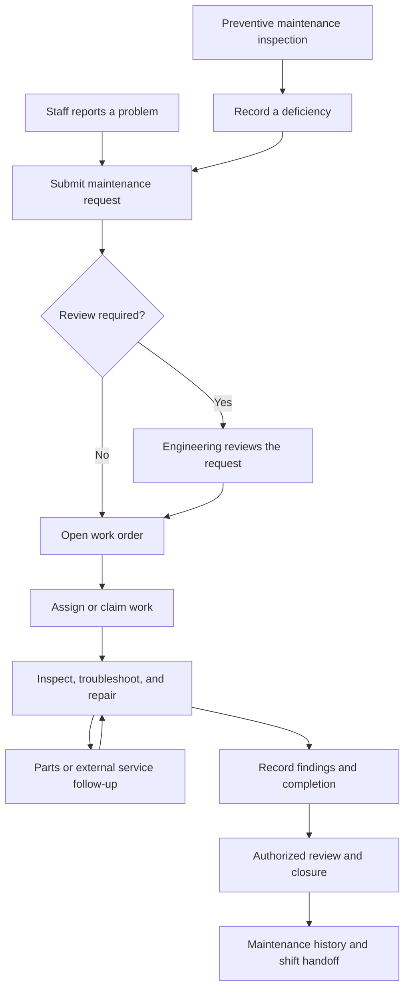

# CMPRI Engineering Overview

CMPRI Engineering connects hotel maintenance reporting, technician work, preventive maintenance, room operations, pool monitoring, purchasing, inventory, and staff communication in a desktop and mobile workspace.

This README explains how work moves through the application: how a problem is reported, reviewed, investigated, repaired, documented, and carried into the next shift.

Application access requires an authorized staff account. This public repository contains documentation and release information. Application source code, operational records, and deployment configuration remain private.

[Open CMPRI Engineering](https://www.cmpri-engineering.com/)

## Contents

- [The operating cycle](#the-operating-cycle)
- [1. Sign in and open the workspace](#1-sign-in-and-open-the-workspace)
- [2. Review the current operating picture](#2-review-the-current-operating-picture)
- [3. Submit a maintenance request](#3-submit-a-maintenance-request)
- [4. Review, prioritize, and assign work](#4-review-prioritize-and-assign-work)
- [5. Investigate and troubleshoot within the work order](#5-investigate-and-troubleshoot-within-the-work-order)
- [6. Complete, close, or reopen work](#6-complete-close-or-reopen-work)
- [7. Run preventive maintenance](#7-run-preventive-maintenance)
- [8. Resolve parts and purchasing needs](#8-resolve-parts-and-purchasing-needs)
- [9. Manage pool checks and operating status](#9-manage-pool-checks-and-operating-status)
- [10. Keep room, location, and equipment records connected](#10-keep-room-location-and-equipment-records-connected)
- [11. Communicate and hand work to the next shift](#11-communicate-and-hand-work-to-the-next-shift)
- [12. Review supporting reports and account tools](#12-review-supporting-reports-and-account-tools)
- [How updates and device caching work](#how-updates-and-device-caching-work)
- [Example of a complete maintenance cycle](#example-of-a-complete-maintenance-cycle)

## The Operating Cycle

A reported problem and a finding from a scheduled inspection can both enter the work-order workflow. The ticket becomes the place to coordinate the repair and preserve its history.

This shows a typical successful repair. Saved drafts, requests awaiting verification, declined work, and reopened tickets are described below. Available actions depend on the staff member’s permissions and the ticket’s current state.

## 1. Sign In and Open the Workspace

After sign-in, CMPRI presents the workspace appropriate to the staff member’s role and permissions.

| Staff function | Typical use |
| --- | --- |
| Front Desk and Housekeeping | Report problems, review permitted work orders, add permitted updates, and communicate with Engineering. |
| Technicians | Work assigned or available tickets, use troubleshooting guidance, document repairs, and perform permitted PM tasks. |
| Engineering leadership | Review requests, coordinate assignments, oversee PM, manage equipment and supplies, and complete authorized closure actions. |
| Management | Review operational information and use the tools granted to the account. |
| Administrators | Maintain authorized user, role, location, and system-management functions. |

On desktop, tools open in movable, resizable windows so staff can keep related information visible together. Mobile layouts adapt the workflows to smaller screens.

Permission checks govern viewing, editing, assignment, approval, and closure separately. Seeing a record does not imply permission to change every field.

## 2. Review the Current Operating Picture

A typical shift begins with the work list, current room information, pool status, scheduled PM, and recent Staff Notes.

### Work Order List

Use the list to locate pending requests, open work, work in progress, completed work, and other available status groups.

Search and sorting help narrow the list by the issue, location, priority, assignment, or supported room context.

Where available, room occupancy, departure information, incoming reservations, and guest-related indicators provide context for coordinating maintenance.

A saved draft can appear for authorized review while remaining distinct from an active work order.

### Daily Room Ops

Authorized staff can load room-status information and supporting departure or guest reports through the available import tools.

The import workflow checks source dates, ordering, coverage, and required details before accepting an update.

The resulting view helps staff understand:

- Current room status.
- Current and incoming occupancy information.
- Expected departures.
- Supporting report details and source context.

This information helps Engineering coordinate room access and plan work around hotel operations.

### Room Ranker

Room Ranker groups rooms by floor and condition rank.

Staff can filter the view and expand additional issues for a room to understand its maintenance context.

These views support planning and coordination. Repair findings and ticket status are recorded in the work order.

## 3. Submit a Maintenance Request

The reporting flow is designed for staff who know what is wrong without necessarily knowing the technical cause.

1. Open **Create Work Order** or the available work-order launcher.
2. Select the room or property location.
3. Describe the problem in plain language, such as “Room 316 is not cooling.”
4. Add photos, video, or notes when they help explain the problem.
5. Enter the reporting name if the account prompts for it.
6. Select **Submit Request** or **Create Work Order**, according to the account’s role.

The simplified form can infer category, priority, and equipment suggestions from the issue and location.

Staff with technical editing permissions can review or adjust the fields available to them.

### Checks During Submission

- Similar active work can trigger a duplicate warning so the reporter can review the existing ticket.
- A report containing several separate problems can present suggestions for separate work orders for review.
- Eligible users can save an unfinished report as a draft and return to it later.
- If a work order is created but an attachment upload fails, the interface provides upload recovery while retaining the saved ticket.

### What Happens After Submission

Requests from submission-only roles enter **Pending Verification**. An authorized reviewer checks them before moving them into active work.

Authorized Engineering submissions can begin as **Open** work orders.

A **Draft** is a saved, unfinished report. It has not yet become a submitted active ticket.

## 4. Review, Prioritize, and Assign Work

Authorized Engineering staff review incoming requests and drafts through the available work lists and approval tools.

During review, staff can:

1. Confirm the room or location and clarify the reported issue.
2. Review possible duplicates and supporting photos or notes.
3. Confirm the associated equipment, category, and priority where permitted.
4. Approve a request for active work or record an appropriate disposition.
5. Assign the ticket to a technician or leave it available for an authorized technician to claim.

The technician opens the ticket and moves the work through the permitted states.

Assignments and status changes remain associated with the work-order record.

| State | Meaning |
| --- | --- |
| **Draft** | An unfinished report saved for later work or authorized review. |
| **Pending Verification** | A submitted request awaiting authorized verification. |
| **Open** | An active work order ready for attention. |
| **In Progress** | Work is underway. |
| **Completed** | The repair or task has been recorded as complete. |
| **Closed** | The ticket has reached authorized final closure. |
| **Will Not Do** | An authorized disposition indicating the work will not proceed. |

Available transitions depend on role, permissions, assignment, and current state.

Completion and final closure are separate actions in the workflow.

## 5. Investigate and Troubleshoot Within the Work Order

Work-order detail brings the reported issue, location, equipment, notes, attachments, assignment, and repair information into one context.

### Technician Workflow

1. Read the issue and available room context.
2. Review reporting notes, photos, and previous findings.
3. Confirm the equipment associated with the ticket.
4. Open **Suggested Troubleshooting**.
5. Perform the appropriate checks.
6. Record observations, readings, diagnostic codes, and work performed.
7. Update permitted ticket fields and status as work progresses.

### Equipment-Matched Troubleshooting

Selecting equipment allows CMPRI to look for verified documentation matching its manufacturer and model family or model number.

When suitable verified documentation is available, the work order can show:

- Troubleshooting steps relevant to the reported issue.
- Matching diagnostic and error-code references.
- Manufacturer guidance and PDF excerpts.
- References to the original manual and specific pages, where available.
- Copy controls for individual steps.

Recorded work notes help filter steps already completed.

If documentation is missing, ambiguous, or does not contain matching guidance, the interface explains the documentation status so the technician can assess the next step.

### Record Findings as Work Happens

Use work-order notes to preserve the repair narrative:

- What was checked.
- What was found.
- What was changed.
- What still needs attention.

Attach supporting media where helpful.

Where linked external activity is available, the ticket can also display related purchases, shipments, service tickets, warranty activity, or supplier follow-up.

These references help the next person understand the repair’s dependencies.

## 6. Complete, Close, or Reopen Work

When the task is finished, the technician records the repair and uses the permitted completion action.

The ticket provides fields for the final action or root cause and, where permitted, parts, cost, labor hours, and other work details.

These records give reviewers and later technicians a useful account of the outcome.

An authorized user can review the completed work and close the ticket.

Work that will not proceed can receive the appropriate **Will Not Do** disposition and explanation.

If further attention is needed after closure, a user with reopening permission can return the ticket to an allowed working state. Ticket history preserves the sequence of updates.

When someone else changes a ticket during editing, CMPRI detects the newer revision and preserves local unsaved text for comparison. Staff must reconcile the current record before submitting an outdated update.

## 7. Run Preventive Maintenance

The PM workspace manages scheduled maintenance alongside reactive repairs.

It combines routine checklists, inspection forms, quarterly room work, approvals, deficiencies, and history.

### The Four PM Sections

| Section | How staff use it |
| --- | --- |
| **Weekly Sheet** | Perform daily, weekly, and monthly routine tasks for the selected period. Each routine checkbox saves independently for its task and date or period. |
| **Inspection Forms** | Open forms due in the selected week or browse the imported form catalog. Record checklist results, readings, inspection rows, initials, and required details. |
| **Quarterly PM** | Search guest rooms, open room checklists, record room condition/rank and deficiencies, and enter quarterly completion dates. |
| **Maintenance History** | Review saved checklist responses, inspection records, and room completion information, with export options. |

### Choose the Period

Use the week selector or **This week** control to choose the working period.

The workspace shows:

- Routine progress.
- Forms still open.
- Items needing follow-up.
- Work awaiting authorized review.

On mobile, frequency and day controls help staff work through the relevant daily, weekly, or monthly checks.

### Perform Routine Checks

Each routine mark belongs to its own task and period. Staff record completion as they perform the work.

A technician’s completion mark and a reviewer’s approval are tracked separately.

Reviewer views distinguish work needing approval from approved work. Technician views show their recorded completion.

**Needs Approval** helps authorized reviewers find work requiring attention.

### Complete an Inspection Form

1. Open the scheduled form or select one from the catalog.
2. Enter its required inspection details.
3. Mark checklist items complete, needs follow-up, or not applicable.
4. Add required measurements or repeatable inspection rows.
5. Record observations, deficiencies, and the follow-up plan.
6. Use **Save draft** while work remains unfinished.
7. Use **Mark complete** when the required information is entered.

The form keeps its source-document reference.

Required fields and follow-up notes help make the resulting record usable for review.

### Complete Quarterly Room PM

Open the room’s PM form and:

1. Perform the room checklist.
2. Record room condition/rank.
3. Document deficiencies.
4. Enter the completion date.
5. Save or complete the form using the available actions.

The room’s completion date, individual checklist responses, and review status carry different information.

Checking an individual item does not by itself complete the entire room PM.

### Create a Linked Repair

When an inspection identifies a deficiency, staff with permission can create a linked work order from the form:

1. Describe the deficiency and required follow-up.
2. Select the work-order location.
3. Create the linked work order.
4. Continue the repair through the normal work-order workflow.

The linked ticket carries the form reference, inspection period, marked deficiencies, and follow-up notes.

Staff can return to the linked work order from the PM form.

### Review and Export

Authorized reviewers review submitted PM work and use the available approval or rejection actions.

Excel and CSV exports provide copies for reporting and record review.

Pool readings are entered in **Pool Log**, with access through the linked PM form where applicable.

## 8. Resolve Parts and Purchasing Needs

A repair may depend on supplies, replacement equipment, a vendor proposal, or a shipment.

Inventory and purchasing tools organize those dependencies.

### Inventory and Vendor Records

Authorized staff can maintain:

- Inventory items and quantities.
- Vendors and vendor contacts.
- Equipment compatibility.
- Reorder information.
- Order ideas.
- Repair-or-replace proposals.

A typical supply workflow is:

1. Identify the required item or equipment.
2. Check the inventory record and available quantities.
3. Record a purchasing need or vendor proposal when additional supply is required.
4. Create or review the purchase order through the available purchasing tools.
5. Track shipment and backorder information.
6. Record the quantity physically received.
7. Document parts used and remaining repair work on the associated ticket.

### Purchase Orders and Receiving

Purchase orders can be entered manually or brought through configured source-review/import workflows.

Authorized staff review acceptance, item descriptions, quantities, inventory mapping, and package or unit conversion before receiving stock.

Shipment information provides delivery context. Physical receipts determine what has actually been received into inventory.

Partial receiving supports an order arriving in several deliveries.

Cumulative receiving records the total received to date and adds the newly received difference.

**Example:** An order contains four cases of filters, with twelve filters per case.

- Receiving two cases adds twenty-four filters.
- When the remaining two cases arrive, updating the cumulative received total to four adds the remaining twenty-four filters.
- Saving that unchanged total again preserves the same received quantity.

Order evidence, receiving history, and recorded values support later review.

Source imports and connected supplier workflows depend on the integrations enabled for the deployment.

## 9. Manage Pool Checks and Operating Status

Pool operations combine the daily testing record with the shared **Pool** status control.

1. Open **Pool Log** and select the relevant facility and date.
2. Enter required test results, observations, and operational checks.
3. Save the log and record retests or follow-up when needed.
4. Review the resulting shared pool status and closure reason.
5. Use an authorized reopening action when the recorded conditions permit it.

The effective operating status considers:

- Configured operating hours.
- Required testing.
- Recorded failures.
- Manual holds.
- Pending authorized reopening.

A closed state can remain in place while testing or an authorized reopening decision is pending.

Staff with the relevant permissions can record closure reasons and manage holds or reopening.

Pool-closure notifications reach eligible recipients through the available notification channels.

Linked PM checks use the Pool Log workflow for the actual readings, keeping the maintenance checklist connected to the testing record.

## 10. Keep Room, Location, and Equipment Records Connected

### Manage Locations

Location records provide the common reference used by work orders, equipment, and PM.

Authorized staff can open a location to review its details and related maintenance information.

**Edit Location** provides Area and Location Type dropdowns based on existing options.

**Open PM Tracker** sits beside it for the available PM reference workflow.

### Assets and Documentation

Equipment records identify the asset, its assigned location, and available manufacturer/model details.

Documentation can be associated with that equipment and verified for use in troubleshooting.

Keeping equipment identity and location accurate helps technicians select the correct item and retrieve relevant guidance from the work order.

### Enseo Assignments

Authorized staff can record television and set-top-box assignments, destination rooms, room sub-locations, and supported pairing or endpoint details.

Recorded moves preserve assignment history for later investigation.

### Front Desk Quick Guides

Available guest-room, television, and door-lock reference material supports permitted staff handling common operational questions.

These guides complement the equipment-specific troubleshooting available to technicians within work orders.

## 11. Communicate and Hand Work to the Next Shift

### Staff Notes

Use **Staff Notes** for shift information, coordination, and discussion.

Staff can:

- Post notes.
- Reply to existing conversations.
- Attach supported media.
- Select supported mentions for people, roles, locations, or work orders.

Work-order references help readers return to the relevant repair record.

Shared Front Desk accounts capture a posting name so a handoff identifies the person communicating.

Unread indicators help eligible staff locate notes requiring attention.

### Notifications

In-app notifications direct eligible users to requests, assigned work, mentions, pool closures, and other supported events.

Device push notifications are available where enabled and permitted by the browser or device.

### End-of-Shift Handoff

A typical handoff includes:

1. Bring work-order notes and statuses up to date.
2. Identify repairs awaiting parts, vendor action, access, or further diagnosis.
3. Save unfinished PM forms and document deficiencies.
4. Confirm pool readings, holds, and closure reasons are recorded.
5. Post a Staff Note linking the work that the next shift needs to continue.

Keep the repair’s findings and status in its work-order record. Use Staff Notes to coordinate the handoff around that record.

## 12. Review Supporting Reports and Account Tools

Additional tools support oversight and administration according to permissions.

| Tool | Operational use |
| --- | --- |
| **GSS Reports** | Review available guest-satisfaction reports, rankings, and prior reporting periods. |
| **Hours Tracker** | Maintain permitted personal hours and leave information. |
| **Candidate Questionnaires** | Allow authorized reviewers to inspect employment questionnaires. |
| **Manage Users** | Maintain authorized user access and role assignments. |
| **Manage Profile** | Maintain available personal preferences and account settings. |
| **Feedback** | Submit application feedback for authorized review. |
| **ChatGPT Connection** | Use supported connected actions where configured and authorized for the individual account. |

The tools shown and the actions available depend on the account.

Connected services retain the user’s applicable permissions.

## How Updates and Device Caching Work

CMPRI caches suitable information locally to make repeat views faster and reduce unnecessary requests.

Open windows and browser tabs receive change notifications so affected views can refresh.

Cached application information remains scoped to the signed-in user, property, and permissions.

Sign-out clears the application’s device data cache. Sensitive categories use restricted caching or continue through network requests.

Local caching supports faster reads. Online authorization and successful saves remain part of the operational workflow; this is not a general offline work-order submission system.

### Seasonal Artwork

Seasonal artwork uses a separate local asset cache.

The approved Thanksgiving layouts include the turkey, separate pumpkins, greeting, and layered leaves for desktop and mobile.

Cached artwork can load and animate offline. Animation does not repeatedly fetch database records.

Changed artwork files receive updated content versions.

## Example of a Complete Maintenance Cycle

1. A Front Desk staff member reports that a guest-room air conditioner is not cooling and attaches a photo.
2. The request enters verification. Engineering reviews the location, issue, priority, and associated equipment.
3. The approved ticket is assigned to a technician.
4. The technician opens the work order, reads prior notes, and checks the available equipment-matched troubleshooting guidance.
5. Inspection identifies a replacement part. The technician records the findings, and authorized staff review stock or purchasing needs.
6. The part is obtained through the appropriate inventory or receiving workflow.
7. The technician completes the repair and records the action, root cause, and permitted work details.
8. The technician marks the work complete.
9. An authorized user performs the final closure action.
10. Work-order history remains available for later review, and any remaining operational follow-up is communicated in the shift handoff.

A scheduled PM inspection can enter the same cycle by creating a linked work order from a documented deficiency.

## Release and Validation

The November 7, 2026 release included:

- Shared modal palette improvements.
- Manage Locations updates.
- Site-wide scrollbar cursor repairs.
- Consistent mobile action-button widths.
- Application data caching.
- Approved Thanksgiving desktop and mobile layouts.

Validation included automated tests, a production build, and desktop/mobile browser checks.

Live checks verified release assets, unauthenticated access denial on protected APIs, and offline playback of cached seasonal animation.

Authenticated role workflows were tested with synthetic accounts in an isolated environment.

## About This Repository

`cmpri-engineering-overview` is the public documentation repository for CMPRI Engineering.

It explains the application and its operating workflows while the development repository and operational information remain private.
