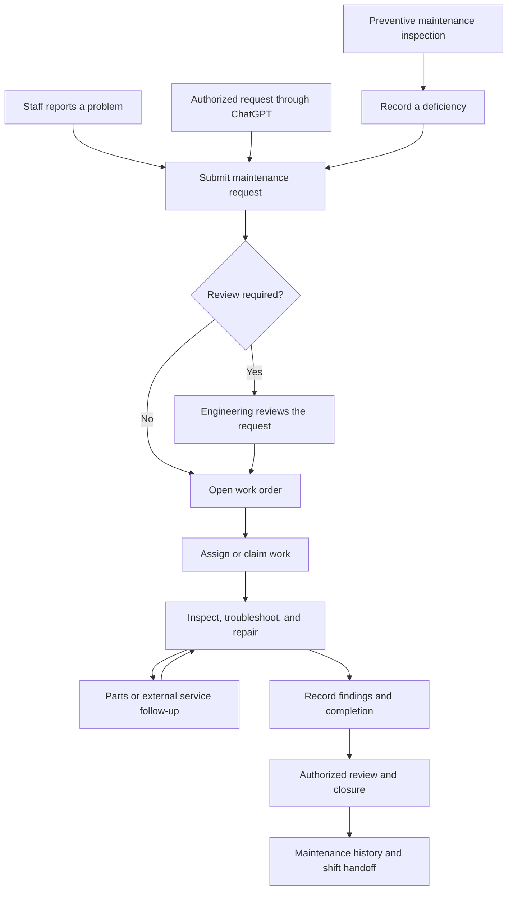

# CMPRI Engineering Overview

CMPRI Engineering connects hotel maintenance reporting, technician work, preventive maintenance, room operations, pool monitoring, purchasing, inventory, and staff communication in a desktop and mobile workspace.

An optional ChatGPT connection provides conversational access to supported records and actions.

This README explains how work moves through the application—from reporting a problem through review, troubleshooting, repair, documentation, and shift handoff.

Application access requires an authorized staff account. This public repository contains documentation and release information. Application source code, operational records, and deployment configuration remain private.

[Open CMPRI Engineering](https://www.cmpri-engineering.com/)

## Contents

- [The operating cycle](#the-operating-cycle)
- [1. Sign in and open the workspace](#1-sign-in-and-open-the-workspace)
- [2. Review the current operating picture](#2-review-the-current-operating-picture)
- [3. Submit a maintenance request](#3-submit-a-maintenance-request)
- [4. Review, prioritize, and assign work](#4-review-prioritize-and-assign-work)
- [5. Troubleshoot within the work order](#5-troubleshoot-within-the-work-order)
- [6. Complete, close, or reopen work](#6-complete-close-or-reopen-work)
- [7. Run preventive maintenance](#7-run-preventive-maintenance)
- [8. Resolve parts and purchasing needs](#8-resolve-parts-and-purchasing-needs)
- [9. Manage pool operations](#9-manage-pool-operations)
- [10. Maintain locations and equipment](#10-maintain-locations-and-equipment)
- [11. Communicate and hand off work](#11-communicate-and-hand-off-work)
- [12. Supporting reports and account tools](#12-supporting-reports-and-account-tools)
- [ChatGPT integration](#chatgpt-integration)
- [Updates and device caching](#updates-and-device-caching)
- [Example maintenance cycle](#example-maintenance-cycle)

## The Operating Cycle

A staff report, an authorized ChatGPT request, or a finding from a scheduled inspection can enter the work-order workflow.

The ticket becomes the place to coordinate the repair and preserve its history.

This illustrates a typical successful repair. Drafts, requests awaiting verification, declined work, and reopened tickets follow the rules described below.

Available actions depend on the staff member’s permissions and the record’s current state.

## 1. Sign In and Open the Workspace

After sign-in, CMPRI presents the workspace appropriate to the staff member’s role and permissions.

| Staff function | Typical use |
| --- | --- |
| Front Desk and Housekeeping | Report problems, review permitted work orders, add permitted updates, and communicate with Engineering. |
| Technicians | Work assigned or available tickets, use troubleshooting guidance, document repairs, and perform permitted PM tasks. |
| Engineering leadership | Review requests, coordinate assignments, oversee PM, manage equipment and supplies, and perform authorized closure actions. |
| Management | Review operational information and use tools granted to the account. |
| Administrators | Maintain authorized user, role, location, and system-management functions. |

On desktop, tools open in movable, resizable windows so staff can keep related information visible together.

Mobile layouts adapt the workflows to smaller screens.

Viewing, editing, assignment, approval, and closure are separate permissions. Seeing a record does not imply permission to change every field.

## 2. Review the Current Operating Picture

A typical shift begins with the work list, current room information, pool status, scheduled PM, and recent Staff Notes.

### Work Order List

Use the list to locate pending requests, open work, work in progress, completed work, and other available status groups.

Search and sorting help narrow the list by issue, location, priority, assignment, or supported room context.

Where available, occupancy, departure information, incoming reservations, and guest-related indicators help staff coordinate maintenance.

Saved drafts remain distinct from submitted active work orders.

### Daily Room Ops

Authorized staff can load room-status information and supporting departure or guest reports through the available import tools.

Imports check source dates, ordering, coverage, and required details before accepting an update.

The resulting view helps staff understand:

- Current room status.
- Current and incoming occupancy information.
- Expected departures.
- Supporting report details and source context.

These records help Engineering plan room access and coordinate work around hotel operations.

### Room Ranker

Room Ranker groups rooms by floor and condition rank.

Staff can filter rooms and expand additional issues to understand the maintenance context for a room.

Repair findings and ticket status are recorded in the work order.

## 3. Submit a Maintenance Request

Staff can report a problem without needing to diagnose its technical cause.

1. Open **Create Work Order** or the available work-order launcher.
2. Select the room or property location.
3. Describe the problem in plain language—for example, “Room 316 is not cooling.”
4. Add photos, video, or notes when helpful.
5. Enter the reporting name if prompted.
6. Select **Submit Request** or **Create Work Order**, according to the account’s role.

The simplified form can infer category, priority, and equipment suggestions from the issue and location.

Staff with technical editing permissions can review or adjust the available fields.

### Submission Checks

- Similar active work can trigger a duplicate warning.
- A report containing several separate problems can present suggestions for separate work orders.
- Eligible users can save unfinished reports as drafts.
- Attachment-upload recovery retains a ticket that has already been created.

### After Submission

Requests from submission-only roles enter **Pending Verification** for authorized review.

Authorized Engineering submissions can begin as **Open** work orders.

A **Draft** is a saved, unfinished report that has not yet become a submitted active ticket.

## 4. Review, Prioritize, and Assign Work

Authorized Engineering staff review incoming requests and drafts through the available work lists and approval tools.

During review, staff can:

1. Confirm the location and clarify the issue.
2. Review possible duplicates and supporting media.
3. Confirm equipment, category, and priority where permitted.
4. Approve the request for active work or record another appropriate disposition.
5. Assign the ticket or leave it available for an authorized technician to claim.

Assignments and status changes remain associated with the ticket.

| State | Meaning |
| --- | --- |
| **Draft** | An unfinished report saved for later work or authorized review. |
| **Pending Verification** | A submitted request awaiting authorized verification. |
| **Open** | Active work ready for attention. |
| **In Progress** | Work is underway. |
| **Completed** | The repair or task has been recorded as complete. |
| **Closed** | The ticket has reached authorized final closure. |
| **Will Not Do** | An authorized disposition indicating that the work will not proceed. |

Available transitions depend on role, permissions, assignment, and current state.

Completion and final closure are separate actions.

## 5. Troubleshoot Within the Work Order

Work-order detail brings the issue, location, equipment, notes, attachments, assignment, and repair information into one context.

### Technician Workflow

1. Read the reported issue and available room context.
2. Review notes, photos, and previous findings.
3. Confirm the associated equipment.
4. Open **Suggested Troubleshooting**.
5. Perform the appropriate checks.
6. Record observations, readings, diagnostic codes, and work performed.
7. Update permitted fields and status as work progresses.

### Equipment-Matched Guidance

Selecting equipment allows CMPRI to look for verified documentation matching its manufacturer and model family or model number.

When suitable documentation is available, the ticket can show:

- Issue-relevant troubleshooting steps.
- Matching diagnostic and error-code references.
- Manufacturer guidance and PDF excerpts.
- Links to original manuals and referenced pages.
- Copy controls for individual steps.

Recorded work notes help filter steps already completed.

The interface explains when documentation is missing, ambiguous, or does not contain matching guidance.

### Preserve the Repair Narrative

Use work-order notes to record:

- What was checked.
- What was found.
- What was changed.
- What still needs attention.

Attach supporting media where helpful.

Where linked external activity is available, the ticket can display related purchases, shipments, service tickets, warranty activity, or supplier follow-up.

## 6. Complete, Close, or Reopen Work

When the task is finished, the technician records the repair and uses the permitted completion action.

Available fields include the final action or root cause and, where permitted, parts, cost, labor hours, and other work details.

An authorized user can review completed work and close the ticket.

Work that will not proceed can receive **Will Not Do** and an explanation.

A user with reopening permission can return a closed ticket to an allowed working state when further attention is needed.

Ticket history preserves the sequence of updates.

If someone changes a ticket during editing, CMPRI detects the newer revision and preserves local unsaved text for comparison. Staff must reconcile the current record before submitting an outdated update.

## 7. Run Preventive Maintenance

The PM workspace combines recurring checklists, inspection forms, quarterly room maintenance, approvals, deficiencies, and history.

### PM Sections

| Section | Operational use |
| --- | --- |
| **Weekly Sheet** | Perform daily, weekly, and monthly routine tasks. Each checkbox saves independently for its task and date or period. |
| **Inspection Forms** | Open scheduled forms or browse the imported catalog. Record results, readings, inspection rows, initials, and required details. |
| **Quarterly PM** | Search rooms, perform room checklists, record condition/rank and deficiencies, and enter completion dates. |
| **Maintenance History** | Review saved checklist responses, inspection records, and room completion information, with export options. |

### Choose the Period

Use the week selector or **This week** control.

Progress indicators show routine completion, open forms, and items needing follow-up.

Mobile frequency and day controls help staff work through the relevant checks.

### Routine Checks and Approval

Each mark belongs to its own task and period.

Technician completion and reviewer approval are tracked separately.

Reviewer views distinguish work needing approval from approved work. Technician views show recorded completion.

**Needs Approval** helps authorized reviewers find pending work.

### Inspection Forms

1. Open the scheduled form or choose one from the catalog.
2. Enter required inspection details.
3. Mark items complete, needs follow-up, or not applicable.
4. Add required measurements or inspection rows.
5. Record observations, deficiencies, and the follow-up plan.
6. Use **Save draft** while unfinished.
7. Use **Mark complete** when required information is entered.

The form retains its source-document reference.

### Quarterly Room PM

Open the room’s PM form, perform its checklist, record condition/rank, document deficiencies, and enter the completion date.

The room’s completion date, checklist responses, and review status carry different information.

Checking one item does not by itself complete the entire room PM.

### Linked Deficiency Work Orders

When an inspection identifies a repair need:

1. Describe the deficiency and required follow-up.
2. Select the work-order location.
3. Create the linked work order.
4. Continue through the normal repair workflow.

The ticket carries the form reference, inspection period, marked deficiencies, and follow-up notes.

The PM form provides access to the linked ticket.

### Review and Export

Authorized reviewers use the available approval or rejection actions.

Excel and CSV exports provide copies for reporting and record review.

Pool readings are entered in **Pool Log**, accessible through the linked PM form where applicable.

## 8. Resolve Parts and Purchasing Needs

Inventory and purchasing tools organize supplies, replacement equipment, vendor proposals, and shipments needed for repairs.

Authorized staff can maintain inventory items, vendors, contacts, equipment compatibility, reorder information, order ideas, and repair-or-replace proposals.

### Supply Workflow

1. Identify the required item or equipment.
2. Check inventory and available quantities.
3. Record a purchasing need or vendor proposal.
4. Create or review the purchase order.
5. Track shipments and backorders.
6. Record quantities physically received.
7. Document parts used and remaining work on the repair ticket.

### Purchase Orders and Receiving

Orders can be entered manually or brought through configured source-review/import workflows.

Before receiving stock, authorized staff review acceptance, descriptions, quantities, inventory mapping, and package or unit conversion.

Shipment information provides delivery context. Physical receipts establish what has been received into inventory.

Partial receiving supports multiple deliveries.

Cumulative receiving records the total received to date and adds the newly received difference.

**Example:** Four cases are ordered, with twelve filters per case.

- Receiving two cases adds twenty-four filters.
- Updating the cumulative received total to four after the remaining delivery adds the remaining twenty-four.
- Saving the unchanged total again preserves the same received quantity.

Order evidence, receiving history, and recorded values support later review.

Connected supplier and import workflows depend on the integrations enabled for the deployment.

## 9. Manage Pool Operations

Pool operations combine the daily testing record with the shared **Pool** status control.

1. Open **Pool Log** and select the facility and date.
2. Enter required results, observations, and operational checks.
3. Save the log and record retests or follow-up as needed.
4. Review the resulting status and closure reason.
5. Use an authorized reopening action when conditions permit.

Effective status considers operating hours, required testing, recorded failures, manual holds, and pending authorized reopening.

A closed state can remain while testing or a reopening decision is pending.

Permitted users can record reasons and manage holds or reopening.

Closure notifications reach eligible recipients through available notification channels.

Linked PM checks use the Pool Log workflow for actual readings.

## 10. Maintain Locations and Equipment

### Manage Locations

Locations provide the common reference for work orders, equipment, and PM.

Authorized staff can review location details and related maintenance information.

**Edit Location** provides Area and Location Type dropdowns based on existing options.

**Open PM Tracker** provides the available related PM reference workflow.

### Assets and Documentation

Equipment records identify the asset, assigned location, and manufacturer/model details.

Documentation can be associated with equipment and verified for troubleshooting use.

Accurate identity and location records help technicians select the correct equipment and retrieve relevant guidance.

### Enseo Assignments

Authorized staff can record television and set-top-box assignments, destinations, room sub-locations, and supported pairing or endpoint details.

Recorded moves preserve assignment history.

### Front Desk Quick Guides

Available guest-room, television, and door-lock reference material supports permitted staff handling common operational issues.

These guides complement equipment-specific troubleshooting inside technician work orders.

## 11. Communicate and Hand Off Work

### Staff Notes

Staff Notes supports shift information, coordination, and discussion.

Staff can post notes, reply, attach supported media, and select supported mentions for people, roles, locations, or work orders.

Work-order references help readers return to the relevant repair.

Shared Front Desk accounts capture a posting name.

Unread indicators help eligible staff locate notes requiring attention.

### Notifications

In-app notifications direct eligible users to requests, assigned work, mentions, pool closures, and other supported events.

Device push is available where enabled and permitted by the browser or device.

### End-of-Shift Handoff

1. Update work-order notes and statuses.
2. Identify repairs awaiting parts, vendor action, access, or further diagnosis.
3. Save unfinished PM forms and document deficiencies.
4. Confirm pool readings, holds, and closure reasons.
5. Post a Staff Note linking work the next shift needs to continue.

Keep repair findings and status in the work-order record. Use Staff Notes to coordinate the handoff.

## 12. Supporting Reports and Account Tools

| Tool | Operational use |
| --- | --- |
| **GSS Reports** | Review available guest-satisfaction reports, rankings, and prior periods. |
| **Hours Tracker** | Maintain permitted personal hours and leave information. |
| **Candidate Questionnaires** | Allow authorized reviewers to inspect employment questionnaires. |
| **Manage Users** | Maintain authorized access and role assignments. |
| **Manage Profile** | Maintain available preferences and account settings. |
| **Feedback** | Submit application feedback for authorized review. |
| **ChatGPT Connection** | Connect an individual account for the supported conversational workflows below. |

Available tools and actions depend on the account.

## ChatGPT Integration

CMPRI includes an optional ChatGPT connection that lets authorized staff work with supported records through conversation.

Staff can ask questions about accessible information and explicitly request supported changes without navigating every screen individually.

The connection uses **OAuth** and the **Model Context Protocol (MCP)**.

Each person signs in with their own CMPRI account. CMPRI checks active status, property membership, role, permissions, and connection access when tools are used.

### Connect an Account

1. Open **Manage Profile → ChatGPT Connection**, where available, and follow its instructions.
2. In ChatGPT’s app/connector settings, add CMPRI using the endpoint shown in the application and select OAuth authentication.
3. Sign in using the account linked to the CMPRI profile.
4. Approve the requested access.
5. Return to CMPRI to review connection status.

The connection can be read-only or read-and-write, depending on the authorization granted.

This OAuth connection does not require staff to share CMPRI credentials or supply an OpenAI API key.

Custom-connection availability depends on the ChatGPT account and organization settings.

### What ChatGPT Can Read

The connector exposes supported views available to the connected account.

Depending on permissions and configuration:

| Area | Supported uses |
| --- | --- |
| **Work orders** | Search accessible tickets; read a specific ticket, activity, and available attachment information; summarize status, assignments, and findings. |
| **Rooms and daily operations** | Find active locations and read available room-operation records, out-of-order rooms, departures, and detected moves. |
| **Equipment** | Search equipment and read available records, documentation information, and maintenance references. |
| **Inventory and vendors** | Read supported inventory, vendor, compatibility, and proposal records in the engineering catalog. |
| **Purchasing** | Review available purchases, shipments, and related operational records. |
| **Pool** | Read a dated facility log, recorded testing, missing daily checks, and returned operating-status information. |
| **PM references** | Read supported PM workbook references where configured and permitted. |
| **Administration** | Read permitted drafts, feedback, user-management information, and Enseo assignments. |
| **Personal hours** | Read the connected account’s own timesheet where that private feature is enabled. |

ChatGPT can organize returned information into a repair summary, outstanding-work list, or draft handoff.

Saving or posting a result requires a supported action and an explicit request.

### What ChatGPT Can Change

A write requires both a read-and-write connection and the relevant CMPRI permission.

Supported changes include:

- **Work orders:** Create requests, import validated data, update permitted fields, assign work, and change status where authorized. Supported cancellation records **Will Not Do** while retaining history.
- **Drafts:** Create, update, or remove permitted drafts under ownership and supervisory rules.
- **Room operations:** Validate and import structured room reports extracted from supplied images or other supported inputs.
- **Equipment and locations:** Create or update equipment and update permitted room/location records. Verified equipment changes follow documentation revision rules.
- **Engineering catalog:** Create or update supported inventory, vendor, contact, compatibility, order-idea, and proposal records.
- **Purchasing operations:** Update supported purchase or shipment statuses and run an authorized mailbox scan where enabled.
- **Pool logs:** Save supplied readings, required daily checks, remarks, and supported retests under normal validation.
- **Enseo assignments:** Save validated batches of device-assignment changes.
- **Profile and administration:** Update permitted profile details, submit or review feedback, and perform authorized user-management actions.
- **Personal hours:** Save the account’s own complete timesheet period where enabled. Clock-in and clock-out are separately activated, account-specific features.

The connector exposes a defined set of actions.

Native PM form completion and approvals, Staff Notes posting, and physical PO receiving are handled through their application workflows when no corresponding connector action is available.

Direct PM spreadsheet writes are currently disabled.

### How a ChatGPT Work-Order Request Flows

For:

> Create a work order for Room 316: the air conditioner is not cooling.

The workflow is:

1. ChatGPT identifies the location and reported issue.
2. An unclear or ambiguous location requires clarification.
3. CMPRI checks submission permission, validates the location, applies attribution and classification rules, and checks duplicates.
4. A successful response returns the created work-order information.
5. The ticket follows the normal verification, assignment, repair, and closure workflow.

For an update, the current record and revision must be checked before permitted changes are submitted.

The tool response determines whether the change succeeded. Preparing a change or validating an import does not confirm that it was saved.

### Room Reports Through ChatGPT

An authorized user can supply report images for ChatGPT to read and prepare:

1. Supply all pages and identify the intended report/date.
2. ChatGPT reads CMPRI’s import requirements and extracts required room information.
3. Current and incoming guest fields remain separate, with printed dates, times, and page details preserved.
4. Unreadable or missing required fields need clarification.
5. The prepared import is validated before saving.
6. When explicitly asked to import, ChatGPT submits the verified data.
7. After success, the saved view can be read back to report out-of-order rooms and detected moves.

### Pool Entry Through ChatGPT

ChatGPT can read the existing log, ask for missing readings or daily checks, and submit values the user supplies.

Normal edit restrictions apply. Existing samples and history are retained.

Returned closure reasons and warnings must be reported back to the user.

Reopening and manual holds continue to follow CMPRI’s operating rules and permissions.

### Example Requests

Each example requires the corresponding access and supported action:

- “Show the work orders I can access for Room 316.”
- “Summarize the findings and remaining work on this ticket.”
- “Create a work order for the lobby: the ceiling light is flickering.”
- “Assign this work order to the technician I selected and mark it In Progress.”
- “Record that the filter was replaced and mark this repair Completed.”
- “Find the equipment and available documentation references for this room.”
- “Read today’s pool log and tell me which required checks are missing.”
- “Validate these report pages and show missing information before saving.”
- “Review the available shipment records for this repair.”

### Access and Revocation

Read-only connections expose permitted reads.

Write-enabled connections additionally expose actions allowed by the user’s current CMPRI permissions.

Every change must be explicitly requested and remains subject to normal validation.

The connection screen provides **Revoke ChatGPT access**. Revocation prevents subsequent use of the revoked connection.

An older read-only connection can be revoked and reconnected with approved read-and-write access where appropriate.

## Updates and Device Caching

CMPRI caches suitable information locally to make repeat views faster and reduce unnecessary requests.

Change notifications help affected windows and browser tabs refresh.

Cached application information remains scoped to the signed-in user, property, and permissions.

Sign-out clears the application’s device data cache. Sensitive categories use restricted caching or continue through network requests.

Local caching supports faster reads. Online authorization and successful saves remain part of the workflow; this is not a general offline work-order submission system.

### Seasonal Artwork

Seasonal artwork uses a separate local asset cache.

The Thanksgiving layouts include an animated turkey, separate pumpkins, greeting, and layered leaves for desktop and mobile.

Cached artwork can load and animate offline without repeatedly fetching database records.

Landed leaves accumulate in persistent piles on their existing layers. The desktop greeting sits at the upper right with clearance for the expanded header.

Changed artwork files receive updated content versions.

## Example Maintenance Cycle

1. Front Desk reports a guest-room air conditioner that is not cooling and attaches a photo.
2. The request enters verification.
3. Engineering reviews the location, issue, priority, and equipment.
4. The approved ticket is assigned to a technician.
5. The technician reviews prior findings and available equipment-matched troubleshooting.
6. Inspection identifies a replacement part.
7. Authorized staff review inventory or purchasing needs.
8. The part is obtained through the appropriate inventory or receiving workflow.
9. The technician completes the repair and records findings, action, root cause, and permitted work details.
10. The technician marks the work complete.
11. An authorized user performs final closure.
12. History remains available, and remaining operational follow-up is included in the shift handoff.

A scheduled PM inspection can enter the same cycle through a linked deficiency work order.

An authorized ChatGPT connection can assist at supported points—for example, creating the initial request, retrieving ticket information, summarizing findings, or submitting a permitted update when explicitly requested.

## Release and Validation

The November 7, 2026 releases included:

- Shared modal palette improvements.
- Manage Locations updates.
- Site-wide scrollbar cursor repairs.
- Consistent mobile action-button widths.
- Application data caching.
- Thanksgiving desktop and mobile layouts.
- Persistent, higher leaf accumulation on existing layers.
- Desktop greeting placement with expanded-header clearance.

Validation included automated tests, production builds, and desktop/mobile browser checks.

Live checks verified release assets, unauthenticated access denial on protected APIs, and offline playback of cached seasonal animation.

Authenticated role workflows were tested with synthetic accounts in an isolated environment.

## About This Repository

`cmpri-engineering-overview` is the public documentation repository for CMPRI Engineering.

It explains the application, operating workflows, and supported ChatGPT integration while the development repository and operational information remain private.
